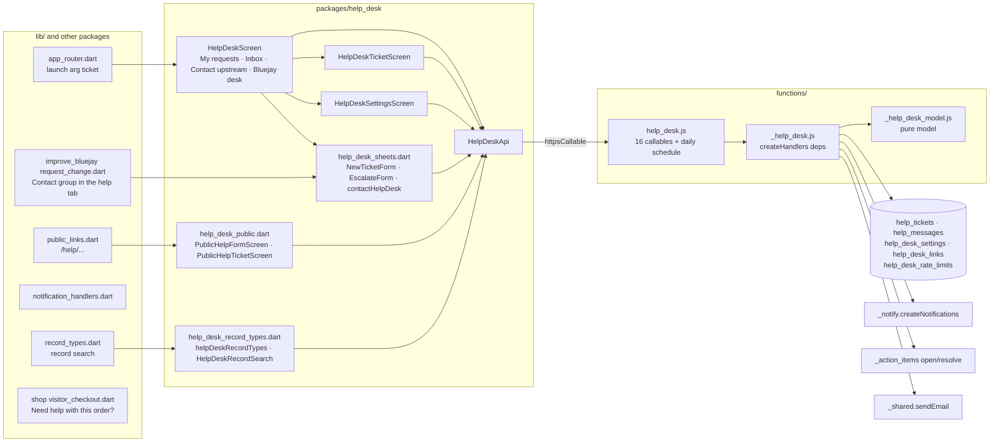
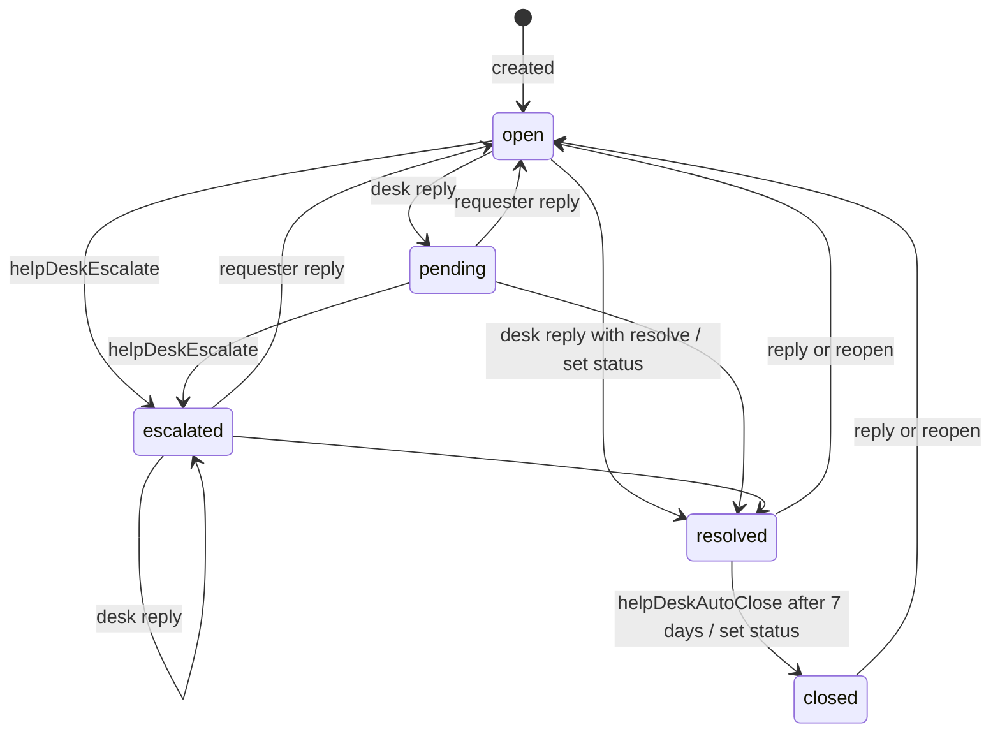

# Help Desk — Developer Guide

Help Desk (`appId: help-desk`, package `packages/help_desk`) is the support-ticket app: a group's customers, guests and members ask its admins, the admins escalate to (or ask) the desk above them, and Bluejay staff answer the Bluejay desk. It handles support requests only; change requests stay in Improve Apps and the development queue. The design is in `plans/help-desk/DESIGN.md` (business suite phase 8).

All ticket data is server-only. The client reads nothing from Firestore: every read and write goes through the `helpDesk*` callables, which work out on every call which side of a ticket the caller is on.

## Architecture

### Main components

| File | Role |
|---|---|
| `functions/help_desk.js` | Exports the callables and the `helpDeskAutoClose` schedule (`17 3 * * *`, `PLATFORM_TIME_ZONE`). Builds the handlers lazily with `createHandlers(defaultDeps())`. Public callables also pass `{ip: clientIp(request)}`. |
| `functions/_help_desk.js` | `createHandlers(deps)`: every handler as `(uid, data, extra)`, so tests run them on the fake Firestore. Owns reads, recipient resolution, notifications, To dos, emails and the public link flow. `defaultDeps()` returns the production dependencies (the Admin SDK `db` and `Timestamp`, the real clock, `getAccessIndex`, `listPlatformRoleHolders(db, role, {activeOnly: true})`, `createNotifications`, `openActionItem`/`resolveActionItem`, `sendEmail`, `enforceRateLimits`, `hashKey`, `_tokens`), for `help_desk.js` and for any server module that files tickets through `fileOnBluejayDesk`. Also exports `publicFormUrl`, `publicTicketUrl`, `PUBLIC_ROUTE` (`help`) and `VIEWS`. |
| `functions/_help_desk_model.js` | Pure model: collection names, desks and routing, statuses, limits, settings normalisation and validation, `sidesFor`, status transitions, list/message views, the forwarded-thread quote. Shop's storefront also imports it to read `publicIntake`. |
| `help_desk_api.dart` | `HelpDeskApi`, one method per callable (through `BluejayFunctions.instance`), and `helpDeskErrorMessage` for refusals. Screens take an instance so tests pass a fake. |
| `help_desk_models.dart` | `TicketView`, `TicketStatus`, `statusDisplay`, `HelpDeskOverview`, `TicketSummary`, `TicketDetail`, `TicketMessage`, `DeskTools`, `DeskSettings`, `PublicDesk`, `TicketContext`, `relativeTime`. |
| `help_desk_screen.dart` | The tabbed lists, FAB per tab, overflow menu (show resolved and closed, desk settings, Bluejay desk settings), and the `initialTicketId` deep link. |
| `help_desk_ticket_screen.dart` | One ticket: conversation, composer (internal notes, saved replies, send and resolve), desk menu (assign, escalate, file as bug/idea, status). `ChangeFiler` defaults to `fileChangeInImproveApps`. Wraps the page in a `PlaceMarker` with `{ticket: <id>}` and the subject, so Chat's "Link to where I am" reopens the ticket ([platform changes, PR #3364](../platform_changes/developer.md)). |
| `help_desk_record_types.dart` | `ticketArg` (`'ticket'`, the launch arg `AppRouter` reads), `helpDeskRecordTypes` (the `help-desk.ticket` record type, registered in `lib/routing/record_types.dart`) and `HelpDeskRecordSearch`, which runs the launcher's record search through `helpDeskSearch` because tickets can't be queried from the client. |
| `help_desk_sheets.dart` | `NewTicketForm` (with guide suggestions), `showNewTicketSheet`, `contactHelpDesk` (used by other apps' help tab), `mayContactHelpDesk`, `EscalateForm`/`showEscalateSheet`, `GuideSuggester`. |
| `help_desk_settings_screen.dart` | Desk settings for a group desk or the Bluejay desk. |
| `help_desk_public.dart` | `HelpDeskLink` (parses `/help/<groupId>[?order=]` and `/help/<groupId>/t/<token>`), `publicHelpDeskScreenFor`, the signed-out form and ticket pages. |
| `bluejay_app.json` | Manifest: public, `isEmbeddable: true` with `embeddableAccessModes: ["public"]`, `clientPortal: true`, `securityTier: regulated`, `installInGroups: ["bluejay", "developer", "games"]`. |

## Desks, routing and the level above

A ticket's `deskKey` says where it waits:

- `group:<groupId>`: that group's desk, answered by its agents.
- `platform`: the Bluejay desk, answered by staff.

`resolveDesk(groupId, settings)` sends a ticket filed in group G to `platform` when G's `help_desk_settings.routing` is `platform`, otherwise to `group:G`. Staff groups are meant to be set to `platform` after deploy (a platform admin does it in that group's Desk settings); only platform admins can change routing.

`upstreamDesk(groupId, managingGroupId)` is the desk above G: the managing group's desk when `_group_hierarchy.managingGroupId(group)` (`managedBy`, or legacy `devQueue.managedBy`) names another group, otherwise `platform`. Escalation and "Contact {upstream}" both open a ticket there with `requesterKind: 'group'`, `groupId: G`.

Settings live in `help_desk_settings/{groupId}`, or `help_desk_settings/_platform` for the Bluejay desk (group ids never contain `_`). `settingsIdFor(deskKey)` picks one. `normalizeSettings` fills defaults on every read: `routing: 'self'`, intake off, categories `Question, Problem, Account, Order, Other`, no saved replies, `firstResponseHours: 24`, empty welcome.

## Who is who: sides and roles

Every decision is made from the caller's access index (`getAccessIndex(uid)`), re-read on every call. The model's predicates:

| Predicate | True when |
|---|---|
| `isActive(index)` | `status` is `ACTIVE`. |
| `inGroup(index, g)` | Active, `g` in `groups`, and `g` not in `denied_scopes`. Platform roles don't count. |
| `isGroupAgent(index, g)` | `inGroup` and the entitlement `g:help-desk:admin` (the group's admins and owners, with the app installed). |
| `isStaff(index)` | Active and holding the `support` or `admin` platform role. Developers are not staff. |
| `isPlatformAdmin(index)` | Active and holding `admin`. |
| `isGuestIn(index, g)` | `g` in `guest_groups`. |
| `canFileIn(index, g, settings)` | `inGroup`, and either a guest with `guestIntake` on and `g:help-desk:guest`, or a member with `g:help-desk`, `:edit` or `:admin`. |

`sidesFor(ticket, uid, index)` returns `{requester, desk}`:

- **requester**: for a `person` ticket, the caller filed it, is still in the group and still holds some Help Desk entitlement there (`g:help-desk` or `g:help-desk:*`). Guests keep access to their tickets after the group turns guest intake off, as long as they keep the guest entitlement. For a `group` ticket, any agent of the filing group. A `public` ticket has no signed-in requester side.
- **desk**: an agent of the desk's group, or staff for the platform desk.

`loadForCaller` refuses with the same `permission-denied` whether the ticket is missing or the caller is on neither side, so ticket ids can't be probed. When the caller is on both sides (an admin with a ticket on their own desk), `actingSide` picks the desk unless the request passes `as: 'requester'`.

The `support` platform role was added to `PLATFORM_ROLES` (`functions/_platform_access.js`) and to Role Manager's assignable roles in the same merge. It grants nothing in the Firestore rules; only these callables check it.

## Ticket lifecycle

- `statusAfterMessage`: an internal note changes nothing; a requester message always sets `open`; a desk message sets `resolved` with `resolve`, otherwise `pending`, except that an `escalated` ticket stays `escalated`.
- A requester's reply on an escalated ticket moves it to `open`, but `upstreamTicketId` stays set, so `canEscalate` stays false and the ticket can't be escalated a second time.
- `canSetStatus`: nobody sets `escalated` by hand. The desk may set any other status. The requester may set `resolved`, or `open` from `pending`, `resolved` or `closed`.
- `statusFields(status, ts)` is merged with every status change: `active` (true for `open`, `pending`, `escalated`), `waitingOn` (`requester` for `pending` and `resolved`, else `desk`), `resolvedAt`/`closedAt` (set for that status, else null).
- `firstResponseAt` is set on the first non-internal desk reply. `isOverdue` is computed at read time: status `open`, no `firstResponseAt`, and older than the desk's `firstResponseHours`. `helpDeskSetStatus` does not set `firstResponseAt`.
- `helpDeskAutoClose` closes up to 400 tickets per run with `status == 'resolved'` and `resolvedAt` older than 7 days, adding a system message and stamping `lastModifiedBy: 'system:help-desk-auto-close'`. It does not touch `lastActivityAt`.

Every status change by `helpDeskSetStatus`, every escalation and every `linkChange` writes a `system` message; escalation also writes an internal system note recording who escalated and whether the thread was shared.

## Escalation

`helpDeskEscalate` (group desks only, active tickets, once per ticket):

1. Builds the upstream body from the agent's summary, plus, with `shareThread`, `forwardedThread`: the customer-visible, non-system messages as `Name (YYYY-MM-DD HH:MM UTC):\nbody` blocks. Internal notes are never forwarded. The body is cut at 15,000 characters (`LIMITS.body * 3`).
2. Creates the upstream ticket at `upstreamDesk` with `requesterKind: 'group'`, `requesterName: "<group> (<agent>)"`, the same subject, priority and context, no category, and `parentTicketId` pointing back.
3. Adds a visible system message to the original ("We've asked {upstream} for help with this. We'll follow up here.") and an internal one, sets status `escalated` and `upstreamTicketId`, resolves the desk's To do, announces the upstream ticket, and tells the original requester (notification, or email for a public ticket).

Afterwards, every non-internal desk reply on the upstream ticket, and a desk `resolved` status change there, adds an internal `system` note to the parent (`noteOnParent`) quoting the reply. The group's agents relay what they choose; the customer never sees the upstream ticket. The parent stays `escalated` until the group's desk resolves it.

## Notifications, To dos and email

Notifications go through `createNotifications` with `type: 'help_desk'`, `appId: 'help-desk'`, and `context.helpDeskTicketId`; the launcher's `_LaunchArgsHandler('help-desk', …)` turns that into the launch arg `ticket`, which `AppRouter` passes as `HelpDeskScreen(initialTicketId:)`. Recipients are grouped by the group each alert is filed under, and every notification id is `help_<ticketId>_<key>_<uid>`, so retries don't duplicate.

| Event | Recipients | Key |
|---|---|---|
| New ticket (any intake, and the upstream ticket of an escalation) | `deskAgents(deskKey)`, minus the creator | `new` |
| Desk reply (not a note) | `requesterRecipients`: the person, or the filing group's agents. Public: an email instead. | `m<n>` |
| Requester reply | `waitingAgents`: the assignee while they still answer the desk, otherwise every agent | `m<n>` |
| Requester resolves or reopens (signed in) | Every desk agent | `s<n>` |
| Public requester reply or "This solved it" | `waitingAgents` | `p<n>` |
| Assign (to someone else) | The assignee | `assign_<ms>` |
| Escalation | The original requester (or email) | `escalated` |

`n` is the ticket's message count after the write.

- **Group agents** are the group's `adminIds` whose access index passes `isGroupAgent`.
- **Platform staff** are active `support` role holders, or the platform admins when nobody holds `support`, filtered by `isStaff`. Each one's alerts are filed under the first of their groups where they have Help Desk, else their first group.
- **To dos**: for group desks only, `openActionItem` with key `help_desk_ticket__<ticketId>`, `kind: 'help_desk_ticket'`, audience `app_admins` of `help-desk`, excluding a person requester. It opens on a new ticket, a requester reply, a requester reopen, and a public reply, and resolves on any desk reply (`answered` or `resolved`), escalation, a status change to `pending`/`resolved`/`closed`, and a public "This solved it".
- **Email** to public requesters goes through `sendEmail` with `triggeredBy: 'helpDesk'`. Each email mints a fresh 180-day, multi-use link token (`mintLink`); older links keep working until they expire.

Notification, To do and email failures are logged and swallowed; the ticket write has already happened.

## Intake paths

| Path | Callable | Desk | Requester |
|---|---|---|---|
| Help Desk app, **New request** | `helpDeskCreateTicket {target: 'desk'}` | `resolveDesk` | `person` |
| Help Desk app, **Contact {upstream}** | `helpDeskCreateTicket {target: 'upstream'}` (agents only) | `upstreamDesk` | `group` |
| Any app's help tab, **Contact {group}** | `contactHelpDesk` → `helpDeskOverview`, then the same form with `TicketContext(appId, appName)` | `resolveDesk` | `person` |
| `bluejay.gg/help/<groupId>` | `helpDeskPublicSubmit` | `resolveDesk` | `public` |
| Escalation | `helpDeskEscalate` | `upstreamDesk` | `group` |
| Another server module (Data & privacy's deletion requests, `functions/_data_governance.js`) | `fileOnBluejayDesk` handler, no callable | `platform` | `person` or `group` |

Categories are accepted only when they are one of the filing group's own categories, and only for `target: 'desk'` and public submissions; anything else stores `category: ''`. The server accepts any of `normal`, `high`, `urgent` for priority; the member form offers only Normal and High, the upstream form all three.

### Tickets filed by other server modules

`fileOnBluejayDesk({requesterUid, requesterKind, groupId, subject, body, context})` is a handler without a callable. It puts a request that another module received on the Bluejay desk, so staff work it in Help Desk like any other ticket. The calling module has already checked who the requester is and what they may ask for, so the handler applies no access check and no rate limit; it validates the subject and body lengths, creates the ticket with `priority: 'normal'` and no category, and announces it to the desk's staff the way a new ticket is announced. `requesterKind: 'group'` files it for the group's admins, in the shape of a ticket the group opened with the level above; `'person'` files it for the requester alone, with an empty `groupId` when no group is given.

The one caller is `onDeletionRequested` in `functions/_data_governance.js`, which builds its own handlers with `createHandlers(defaultDeps())`, files each new deletion request (group data as `group`, an account as `person`) with `context: {appId, appName: 'Data & privacy'}`, and stores the returned `ticketId` on the request. If filing throws, it notifies the platform admins directly. See `interfaces.md` for the full contract.

### The help tab integration

`packages/improve_bluejay/lib/request_change.dart` (`AppHelpShell`) loads `UserAppEntitlements` for `help-desk` and calls `mayContactHelpDesk(entitlements, activeGroupId)`: active, group not denied, and any `g:help-desk` or `g:help-desk:*` entitlement. That is deliberately looser than `canFileIn`; whether the group actually takes the person's tickets is decided by `helpDeskOverview.canFile` when they tap it (`contactHelpDesk` shows "This group isn't taking requests here yet." otherwise). The option is skipped inside Help Desk itself, and for guests the chooser drops the change-request options (`offerRequests: false`).

### Guide suggestions

`NewTicketForm` debounces typing by 500 ms and, once the subject plus body is at least 8 characters, calls the `GuideSuggester` (default `AppHelpDocs.suggest(text, forGuest:)` from `packages/wiki`). `rankGuides` (`packages/wiki/lib/guide_suggestions.dart`) scores app-audience entries of `feature_doc_mapping.json` by keyword phrases, title words, keyword words and description words, returning up to 3 above a minimum score. A sequence counter drops stale results. Suggestions are off in the upstream form.

### Record search

The launcher's record search finds tickets by subject or requester name. `help_tickets` is `kind: server`, so `HelpDeskRecordSearch` calls `helpDeskSearch` instead of querying Firestore. The handler repeats `helpDeskList`'s per-view checks against the caller's access index: everyone in the group searches their own `person` tickets, and agents also search the desk inbox and the group's upstream tickets. Staff don't search the Bluejay desk this way. Each view is one `searchPrefixes array-contains` query on the most selective term, and the remaining terms are matched in memory. `searchPrefixes` is kept current by the audit-trail trigger from the `search` block in `security/collections.json`, so the Help Desk handlers never write it. Hits open with the `ticket` launch arg. The full contract is in `interfaces.md`.

### The public form and links

- `/help` is a reserved group id (`RESERVED_GROUP_IDS` in `functions/_group_docs.js`) and resolved by `lib/routing/public_links.dart` through `publicHelpDeskScreenFor`. `HelpDeskLink.fromUri` accepts `/help/<groupId>` with an optional `?order=` and `/help/<groupId>/t/<43-char token>`.
- The form and public tickets use the group's outward name, `publicGroupName` → `groupDocumentName` (`functions/_group_identity.js`): its legal name when set, else its name. `helpDeskPublicDesk` returns it, and `helpDeskPublicSubmit` stores it as the ticket's `groupName`, which the confirmation, reply and escalation emails read. Signed-in tickets and the overview keep the group's `name` ([platform changes, PR #3319](../platform_changes/developer.md)).
- `publicSettings` refuses with `not-found` ("This help page is not available.") unless the group exists, has `publicIntake` on and is not `isFrozen`.
- The link token is a `_tokens.js` link token: `help_desk_links/{sha256(token)}` holds `{ticketId, groupId, kind, singleUse: false, createdAtMs, expiresAtMs, …}`. `resolveLink` checks well-formedness, hashes, evaluates the token, and requires the ticket to be `requesterKind: 'public'`; any failure is `not-found`.
- Shop's storefront (`functions/_shop_storefront.js`) returns `helpFormUrl` when the group's settings have `publicIntake`, and the visitor checkout's done step links to it with `order=<first 8 chars of the request id, upper-cased>`. The form then pre-selects the `Order` topic when the group offers it.

## Rate limits

All limits use `_rate_limit.enforceRateLimits` against `help_desk_rate_limits` (`resource-exhausted` when exceeded).

| Operation | Key | Limits |
|---|---|---|
| Signed-in create (desk or upstream) | `uid_<uid>` | 20/hour, 60/day |
| Public submit | `hashKey('submit_ip', ip)` | 5/hour, 20/day |
| Public submit | `hashKey('submit_email', email)` | 5/day |
| Public desk read, public ticket read | `hashKey('read_ip', ip)` | 30/minute |
| Public reply | `hashKey('reply_ip', ip)` | 20/hour |

Signed-in replies, status changes, escalations and assignments are not rate limited.

## Data and permissions

<!-- generated:data-permissions:start -->
<!-- Generated from security/collections.json and security/storage_paths.json by `node scripts/docs/nightly_docs_batch.js render-permissions`. Do not edit between these markers: change the policy table and re-render. -->

**Firestore** — policy from `security/collections.json`, enforced by the generic rule in `firestore.rules`. App tiers are the caller's `<groupId>:<appId>` entitlements (base, `:edit`, `:admin`, `:guest`); "own" docs are those whose `creatorId` is the caller or whose `ownerIds` contains them.

| Collection | Kind | Who reads | Who writes (client) | Notable flags |
|---|---|---|---|---|
| `help_desk_settings` | server | No client reads (platform admins only) | None (Admin SDK only) | — |
| `help_tickets` | server | No client reads (platform admins only) | None (Admin SDK only) | — |
| `help_tickets/{id}/help_messages` | subcollection | As the parent doc | None (Admin SDK only) | The ticket's conversation, append-only: each message records its side, author and time, and is never edited. |

- Every rule requires a signed-in `ACTIVE` account; tenant access also needs the doc's `groupId` in the caller's access index (and not in `denied_scopes`). ACTIVE platform admins read every collection (EX-ADMIN-1).
- Client creates of tenant docs must set `creatorId` to the caller and use an auto id, a UUID, the `groupId`, or a `{groupId}__…` key; `groupId`, `appId` and `creatorId` never change on update. "Admin SDK" writes come from Cloud Functions.
- Subcollections not listed follow their parent: readers of the parent read them, editors of the parent write them, and readers may add `comments` docs they author.

<!-- generated:data-permissions:end -->

All four collections are `kind: server`, so the reasons sit in the handlers rather than the rules: a ticket is filed in one group and answered at another group's desk or the staff desk, and the cross-group checks (requester ↔ desk ↔ upstream) are kept in one place, `sidesFor`, with no new rules construct. `help_tickets` and `help_desk_settings` are on the audit trail (`functions/_audit_collections.json`); every server write carries `lastModifiedBy`/`lastModifiedAt`, using `system:help-desk-public` for signed-out requesters and `system:help-desk-auto-close` for the schedule. Messages in `help_messages` are written once and never edited.

## Performance and limits

| Limit | Value |
|---|---|
| Subject / body | 120 / 5,000 characters |
| Requester name (public) | 80 |
| Categories | 12, each up to 40 |
| Saved replies | 30 (title 60, body 2,000) |
| Welcome | 500 |
| `firstResponseHours` | integer 1 to 168 (the UI offers 4, 8, 24, 48, 72) |
| Context fields | `appId`, `appName`, `platform`, `appVersion` up to 120; `orderRef` up to 80 |
| Linked changes per ticket | 10 |
| List page | 100 tickets |
| Messages read per ticket | the first 500 by `createdAt` |

- `helpDeskList` runs one indexed query ordered by `lastActivityAt desc`, limit 100, then reads each row's group name (cached per call) when the ticket has no `groupName`. The `mine` view filters out `group` tickets after the limit, so a page can hold fewer than 100 rows.
- `helpDeskSearch` runs up to three queries (one per view the caller has) of at most 8 rows each, unordered and without an `active` filter. The own-tickets view drops non-`person` rows after the limit, so it can return fewer than 8.
- `helpDeskGetTicket` for the desk side resolves every agent (one access-index read per admin or staff member) and reads each agent's user doc for names.
- Every recipient resolution re-reads the group doc and each candidate's access index.
- Ticket updates are plain `update`s computed from the ticket read at the start of the call (no transaction). `messageCount` is recomputed from that read.
- Composite indexes (`firestore.indexes.json`): `deskKey + active + lastActivityAt desc`, `deskKey + lastActivityAt desc`, `groupId + requesterUid (+ active) + lastActivityAt desc`, `groupId + requesterKind (+ active) + lastActivityAt desc`, and `status + resolvedAt` for the auto-close.

## Client behaviour worth knowing

- `HelpDeskOverview.views` decides the tabs in order: `mine` (canFile), `inbox` (isAgent), `upstream` (canContactUpstream, same as isAgent), `platform` (isStaff). One view shows without tabs.
- Tab counts are computed client-side from the loaded rows: open tickets for the inbox and the Bluejay desk, pending tickets for the requester views.
- `statusDisplay` labels the same status differently for each side (desk: Needs reply / Waiting on requester; requester: Waiting for reply / Replied).
- The ticket screen shows the composer unless the ticket is closed and the viewer is only on the desk side; a requester can always reply, which reopens it.
- `DeskSettings` from `helpDeskSaveSettings` doesn't carry `platformDesk`, `canChangeRouting` or `publicFormUrl`, so the settings screen keeps those from the first load.
- The public form's Send button stays disabled until name, subject and body are filled in and `isHelpDeskEmail` accepts the email (the pattern and 254-character limit `helpDeskPublicSubmit` applies). Once the email field has lost focus, a non-empty address that fails shows "Enter a valid email address." under the field.
- The "Desk settings" menu item appears for agents and platform admins; "Bluejay desk settings" for staff.

## Automations

Tickets feed [Automations](../automations/developer.md) in the group they
were filed in (`groupId`). The `automation` block on `help_tickets` exposes
the routing fields only: `subject`, `status`, `priority`, `category`, the
requester's kind, name and uid, `assigneeUid`, `waitingOn` and the dates. No
message text and no requester email enter an envelope, and as a regulated
app it lists no `webhookFields`. `record.update` can't change a ticket:
`help_tickets` is kind server.

`functions/_help_desk_automations.js` registers
`help_desk.ticket.created`, `help_desk.ticket.status_changed` and
`help_desk.ticket.resolved`, and two templates: alert the app's admins about
urgent tickets, and tell the assignee when a ticket is reopened.

## Testing

- `functions/_help_desk.test.js` covers the model (routing, guest intake, staff, status moves, settings validation, overdue) and handler flows on the fake Firestore: guest filing, requester solve/reopen, assign, staff routing, the admin fallback for alerts, escalation with and without the thread, managed-group escalation, linking a bug report, settings and routing permissions, the public form and links (including the legal name on the public form, public tickets and their emails), auto-close, `fileOnBluejayDesk`, and record search (what an agent and a member each find, multi-term narrowing, too-short queries, another group's tickets).
- `packages/help_desk/test/help_desk_test.dart` (with `test/fakes.dart`) covers the overview's views, status labels, ticket parsing, relative times, `mayContactHelpDesk`, `HelpDeskLink` parsing, `isHelpDeskEmail`, and the public form's email error.

## Debugging

- **A user can't open Help Desk**: check their access index for `inGroup` (not in `denied_scopes`) and a `g:help-desk*` entitlement; guests also need `guestIntake` in `help_desk_settings/<g>`.
- **Nobody on a group desk gets alerts**: agents are `groups/<g>.adminIds` filtered by `g:help-desk:admin`. An admin without the app's admin tier is not an agent.
- **Bluejay desk alerts going to platform admins**: nobody holds an active `support` role.
- **Public page says "not available"**: `publicIntake` is off, the group is frozen, or the group doc is missing.
- **An old public link stopped working**: links expire after 180 days; each email carries a new one.
- Logs are prefixed `[help desk]` (notification, To do and email failures) and `[helpDeskAutoClose]`.
