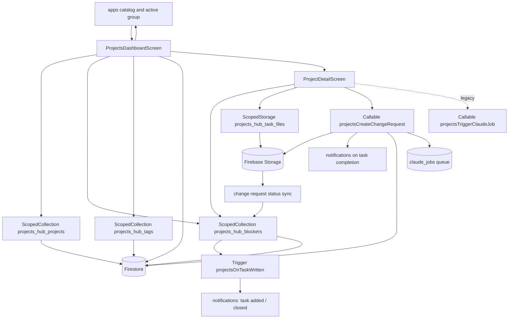

# Projects — Developer Guide

## Scope and entry points

Projects is implemented in:

- `packages/projects/lib/constants.dart`
- `packages/projects/lib/models.dart`
- `packages/projects/lib/projects_access.dart`
- `packages/projects/lib/project_links.dart`
- `packages/projects/lib/projects_dashboard_screen.dart`
- `packages/projects/lib/project_detail_screen.dart`
- `packages/projects/lib/project_styles.dart`
- `packages/projects/lib/project_widgets.dart`

The two screen files own the streams, Firestore reads and writes, callables and the project/task form sheets (`ProjectFormSheet`, `TaskFormSheet`). `project_widgets.dart` holds the presentational widgets and pure helpers (`ProjectsDashboardBody`, `ProjectCard`, `ProjectDetailBody`, `BlockerTaskCard`, `BlockerTree`, `TaskAttachmentsView`, `filterAndSortProjects`, and others); they take plain records and callbacks and never touch Firestore, so `test/project_widgets_test.dart` pumps them with fixture data. `test/screenshots_test.dart` is an opt-in screenshot test whose output (`test/screenshots/out/`) is git-ignored.

The UI is built on the shared `bluejay_design` package (`BjPage`, `BjCard`, `BjStatusPill`, `BjStateView`, `showBjSheet`, `showBjConfirm`, `BjSnack` and so on), a path dependency in `packages/projects/pubspec.yaml`. The package has no theme file of its own.

Related integration points outside the package:

- Route registration: `lib/routing/app_router.dart` maps launcher app ID `'projects'` to `ProjectsDashboardScreen(currentUser: user)`.
- Shared-place routing: with a `project` launch arg, `sharedPlaceScreen` in `lib/routing/shared_place_routes.dart` returns `ProjectsDashboardScreen(initialProjectId:, initialTaskId:)` instead (see [Shared places](#shared-places-chat-links-to-a-project-or-task)).
- Documentation mapping: `packages/shared_services/lib/app_doc_mapping.dart` maps doc slug `'projects'` to app ID `'projects'`.
- Task change requests: `functions/projects.js` exports `projectsCreateChangeRequest`, which creates a linked Improve Apps bug or feature request. `functions/change_requests.js` and `functions/_change_request_links.js` mirror request and pull-request state back to the task.
- Project client-group picker: `functions/projects.js` exports admin-only `projectsListClientGroups`.
- Task alerts: `functions/projects.js` exports the Firestore trigger `projectsOnTaskWritten` on `projects_hub_blockers/{taskId}`, which hands each write to `handleTaskWrite` in `functions/_projects_task_notify.js` (see [Task alerts](#task-alerts)).
- Legacy Claude queue callable: `functions/projects.js` still exports `projectsTriggerClaudeJob` for older clients; the current task menu creates linked change requests instead. Its platform-admin check reads `getAccessIndex`, which uses trusted Firebase Auth claims for platform roles.
- Bundled docs/assets: root `pubspec.yaml` includes `documentation/projects/` in Flutter assets.
- Security policy: the generated Firestore and Storage rules enforce group/app scoping for Projects data and task files; client-side `ProjectsAccess` checks control visible UI actions but are not the authorization boundary.

Project and blocker CRUD remain direct Firestore access from Flutter. The package also reads the root `apps` and active `groups` documents for project links, and uses three package-specific callables for change requests, client-group selection, and legacy task dispatch. Client Firestore access is attributed to the Projects app through the shared metering gateway.

## High-level architecture

## Firestore scoping behavior

Projects uses `ScopedCollection` for its app-owned collections:

- `projects_hub_projects` with `appId = 'projects'`
- `projects_hub_blockers` with `appId = 'projects'`
- `projects_hub_tags` with `appId = 'projects'`

`ScopedCollection` contributes several important behaviors:

- `.query` always injects `where('groupId', isEqualTo: activeGroupId)`.
- If there is no active group, reads are forced onto the sentinel `__no_active_group__` so they return nothing.
- `.add()` injects `groupId`, `appId`, `creatorId`, and `ownerIds`.
- `.doc(id).update(...)` and batch deletes rely on the existing document’s permission fields and the repository’s Firestore rules.

In the security registry, `projects_hub_projects` and `projects_hub_blockers` are tenant collections for the Projects app. `projects_hub_tags` is also tenant-scoped and declares `naturalKeyIds: true`; its canonical document ID is `{groupId}__{percentEncodedLowercaseTagKey}`. Firebase rules enforce the tenant and app policy, including permission-field invariants; do not treat the dashboard’s access stream or action visibility as backend authorization.

`ScopedStorage(folder: 'projects_hub_task_files', appId: 'projects')` stores task files under the group/app Storage namespace. The enforced `group_apps` Storage policy checks the caller’s group/app access and object metadata; the 10 MB per-file limit and extension-to-MIME mapping remain client-side checks.

### Usage attribution

The package attributes client Firestore operations to `APP_ID` (`projects`):

- `ScopedCollection` uses the shared `BluejayFirestore` metering gateway for project, blocker, and reusable-tag queries and writes.
- Reads of `users/{uid}/metadata/access_index`, `groups/{groupId}`, and `apps`, along with project/task delete batches, use `BluejayFirestore.forApp(APP_ID)`.
- The shared gateway records billable reads, writes, and deletes; cache-served reads are free. Batch deletes are attributed to Projects as well.

`functions/projects.js` builds its callables through `_metered_functions`. That gateway derives app attribution from the module and carries verified caller context into usage accounting. It preserves callable arguments, results, and errors; usage accounting does not change the Projects request/response contract.

## Domain model

### Enum wire formats

| Enum | Stored values | Unknown-value fallback |
|---|---|---|
| `ProjectStatus` | `planned`, `active`, `on_hold`, `completed` | `planned` |
| `BlockerStatus` | `todo`, `in_progress`, `done` | `todo` |

### `ProjectRecord`

| Field | Type | Notes |
|---|---|---|
| `id` | `String` | Firestore document ID |
| `title` | `String` | Trimmed on read; required by create/edit form sheet |
| `description` | `String` | Trimmed on read |
| `goal` | `String` | Trimmed on read |
| `status` | `ProjectStatus` | Parsed from stored string |
| `dueDate` | `DateTime?` | From Firestore `Timestamp` |
| `createdAt` / `updatedAt` | `DateTime?` | From Firestore `Timestamp` |
| `ownerId` | `String?` | Retained as project metadata for legacy records and ownership context |
| `memberIds` | `List<String>` | Legacy project roster retained for backward compatibility; no longer used to filter visibility |
| `tags` | `List<String>` | Optional project tags normalized via `normalizeProjectTags` (trimmed, de-duplicated case-insensitively, sorted) |
| `relatedAppIds` | `List<String>` | Bluejay app IDs the project concerns; used to label links and offer request targets |
| `clientGroupIds` | `List<String>` | Groups served by the project; selectable only by platform admins |
| `clientGroupNames` | `Map<String, String>` | Saved group-ID-to-display-name snapshot; raw group ID is the fallback |

### `ProjectTagRecord`

| Field | Type | Notes |
|---|---|---|
| `id` | `String` | Firestore document ID |
| `key` | `String` | Lowercase normalized key for dedupe/reuse |
| `label` | `String` | Group-wide display label used by project forms |

### `BlockerTaskRecord`

| Field | Type | Notes |
|---|---|---|
| `id` | `String` | Firestore document ID |
| `projectId` | `String` | Foreign key to `projects_hub_projects/{projectId}` |
| `title` | `String` | Trimmed on read; required by create/edit dialog |
| `description` | `String` | Trimmed on read |
| `parentTaskId` | `String?` | Dependency edge: this task is blocked by its parent task |
| `status` | `BlockerStatus` | `isDone` is true only for `done` |
| `priority` | `int` | Read fallback `3`; UI constrains edits to 1–5 |
| `dueDate` | `DateTime?` | Optional |
| `createdAt` / `updatedAt` | `DateTime?` | Optional server timestamps |
| `attachments` | `List<TaskAttachment>` | File attachments; items with an empty `url` are filtered out on read |
| `agentQueuedAt` / `agentJobId` / `agentDispatchedAt` / `agentDispatchError` / `prUrl` / `prState` | `DateTime?` / `String?` | Server-written legacy direct-dispatch state; never written by the current app |
| `changeRequest` | `ChangeRequestRef?` | Server-written reference `{itemType, itemId, collection}` to a linked Improve Apps bug or feature request |
| `changeRequestState` | `ChangeRequestState?` | Server-mirrored lifecycle `open`, `queued`, `in_review`, `merged`, `resolved`, or `closed` |
| `changeRequestSyncedAt` | Firestore `Timestamp` | Server-written time for the last linked-request status synchronization |

### `TaskAttachment`

| Field | Type | Notes |
|---|---|---|
| `url` | `String` | Firebase Storage download URL; required; items with empty URL are discarded on read |
| `name` | `String` | Original filename; trimmed on read; falls back to `'Attachment'` in UI |
| `path` | `String?` | Full Firebase Storage object path (e.g. `groups/{groupId}/apps/projects/projects_hub_task_files/...`) |
| `contentType` | `String?` | MIME type derived from file extension at upload time |
| `sizeBytes` | `int?` | File size in bytes as reported by the file picker |
| `uploadedAt` | `DateTime?` | Local `DateTime.now()` captured at upload time (not a server timestamp) |

`TaskAttachment.fromMap` gracefully handles both `Map<String, dynamic>` and untyped `Map` from legacy Firestore reads.

## Main UI flows

### Dashboard (`ProjectsDashboardScreen`)

1. If `currentUser == null`, show a locked `BjStateView` login prompt instead of the feature.
2. Read `users/{uid}/metadata/access_index` through `AccessIndexBuilder(uid: user.uid, appId: APP_ID)`, which uses the session-wide shared access-index listener ([Platform changes](../platform_changes/developer.md), PR #3112), and derive group-scoped create/edit permissions from `ProjectsAccess`. Until the access stream delivers, show `ProjectsDashboardSkeleton`. Without view access, show a locked state instead of the list. With no active group, build `ActiveGroupPending`, which draws nothing; the launcher opens an app only once a group is active.
3. Stream reusable group tags with `_projectTags.query.snapshots()`.
4. Stream visible projects with `_projects.query.snapshots()`. A failure on either stream shows `BjStateView.error` with a **Try again** button that rebuilds (and so resubscribes) the stream.
5. Derive available filter tags with `availableProjectTags`: the union of group tag docs and tags on the streamed projects, one label per key.
6. Count projects per status for the filter chips (`All · N`, `Planned · N`, ...). Counts cover every streamed project, before filtering.
7. Apply optional client-side status and tag filtering and sort with `filterAndSortProjects` (tag filter: `tagKeys.every(projectTagKeys.contains)`):
   - non-completed before completed,
   - then due date ascending with `null` last,
   - then title ascending.
8. Render the cards with `BjResponsiveGrid.rows` (minimum tile width 420, at most two columns). When nothing is visible, show **No projects yet** (no projects at all) or **No projects match these filters** with a **Clear filters** action.
9. For each visible project card, fetch blockers once with `_loadNextAction(project.id)` and compute one actionable task; `NextActionStrip` shows a skeleton line while that read is pending.

Dashboard actions are now gated by group access:

- base entitlement (`groupId:projects`) → view + create + duplicate,
- edit/admin entitlement (`groupId:projects:edit` or `:admin`) → edit + delete.

### Project create/edit writes

Project create/edit/duplicate opens `ProjectFormSheet` through `showBjSheet`: a scrolling modal bottom sheet that lifts above the keyboard and is capped at 640 px wide. The sheet pops a `_ProjectFormResult`; `_showProjectForm` on the screen does the write. The write payload contains:

- `title`
- `goal`
- `description`
- `tags`
- `status`
- `dueDate`
- `ownerId`
- `memberIds`
- `relatedAppIds`
- `clientGroupIds`
- `clientGroupNames`
- `updatedAt`
- plus `createdAt` on create

Notable behavior:

- Creates set `ownerId` to the current user UID, initialize `memberIds` to `[currentUser.uid]`.
- Edits preserve the existing `ownerId` and `memberIds`.
- The form requires only `title` (a `TextFormField` validator shows `Project name is required`) and keeps `goal` / `description` optional.
- Status input is a single-tap `StatusChoiceChip` selection; the due date uses `BjDateField` (**Pick date** / **Change**, plus a clear button once set).
- Tags are entered through a text field + add button, shown as removable chips, normalized before save, and canonicalized against reusable group tags when a matching key already exists.
- New tags are written to `projects_hub_tags` the first time they are saved.

### Project duplicate flow

`_showProjectForm` accepts either `project` (edit) or `duplicateFrom` (duplicate), with an assertion preventing both at once.

- `ProjectFormSheet`'s state seeds its controllers from `widget.project ?? widget.duplicateFrom`.
- The duplicate path sets `widget.project == null`, so save still goes through the **create** branch.
- As a result, duplication copies editable project metadata (`title`, `goal`, `description`, `status`, `tags`, app links, client-group links/name snapshots, and `dueDate`).
- The newly created project gets a fresh `ownerId = currentUser.uid`, `memberIds = [currentUser.uid]`, and new `createdAt` / `updatedAt` server timestamps.
- No blocker tasks are cloned, because duplication never reads or writes `projects_hub_blockers`.

### Project delete flow

`_deleteProject` first counts the project's blockers so the `showBjConfirm` dialog can list what is lost (the project and its metadata, `Its N blocker tasks are deleted` or `It has no blocker tasks`, and that it can't be undone; if the count read fails it falls back to `All of its blocker tasks are deleted`). After confirmation it queries the blockers again and deletes every blocker doc plus the project doc in one Firestore batch.

### Reusable tag flow

`projects_hub_tags` stores one reusable tag document per normalized tag key in each group. The create/edit form:

1. Loads the group tag list.
2. Suggests matching reusable tags as quick chips while the user types.
3. Reuses the stored `label` when the new input matches an existing `key`.
4. Creates a new tag doc only when the normalized key does not already exist.

The tag key is lowercase and percent-encoded before `ScopedCollection.docForKey` builds the canonical ID `{groupId}__{key}` (for example, `group-123__urgent%20work`). The `*ForKey` helpers read and write only that ID; the M4 rekey moved the former `{groupId}:{key}` records to it without changing tag labels or project values.

## Detail screen behavior (`ProjectDetailScreen`)

1. Stream all blockers for the current project with `_projectTasks.query.where('projectId', isEqualTo: widget.project.id).snapshots()`. `BjSnapshotView` shows `ProjectDetailSkeleton` while loading and an error state with **Try again** on failure; no view access shows a locked state, and no active group builds `ActiveGroupPending`.
2. Build a `BlockerTree` (in `project_widgets.dart`) from the snapshot. With `hideCompleted`:
   - `false`: `visible` is all tasks and `topLevel` is the tasks with no parent.
   - `true`: `visible` filters out `done` tasks, and tasks whose parent is hidden are promoted to `topLevel` so unfinished branches remain visible.
3. `BlockerTree.actionable` holds tasks that are not done and whose direct children are all done, sorted by priority ascending (lower number first), due date ascending (`null` last), then title.
4. `ProjectSummaryHero` shows the goal (or `No goal defined yet.`), description, a progress bar with a percentage (`doneCount / tasks.length`), `N of M blocker tasks completed`, and status, due, tag and link pills. It uses the compact hero title below the compact breakpoint.
5. `NextTasksCard` lists up to five actionable tasks with priority pills, plus `+N more in the flow map` when there are more.
6. From the `BjBreakpoint.expanded` width up, `ProjectDetailBody` places `NextTasksCard` in a 340 px sidebar beside the blocker flow map; narrower screens stack hero, next tasks and map.
7. Each task in the map is a `BlockerTaskCard` with checkbox, status/priority/due pills, an `N open blockers` pill when it has unfinished direct children, change-request status, attachments and a `BjOverflowMenu`. Nested tasks are indented behind an accent rail (`_TreeRail`).

Status labels, icons and `BjTone`s for project statuses, task statuses and change-request states come from one map each in `project_styles.dart` (`projectStatusStyles`, `blockerStatusStyles`, `changeRequestStateStyles`); change-request labels reuse `changeRequestStateLabel` so they match Improve Apps. `priorityTone` marks P1 as danger, P2 as warning and the rest as neutral. Due-date pills (`BjDuePill`) read `Due YYYY-MM-DD`, or `Overdue YYYY-MM-DD` once the date has passed on a project or task that isn't done.

### Task writes

Create/edit writes:

- `projectId`
- `title`
- `description`
- `parentTaskId`
- `status`
- `priority`
- `dueDate`
- `attachments`
- `updatedAt`
- plus `createdAt` on create

Checkbox completion writes only:

- `status` (`done` or `todo`)
- `closedBy` (the current user's uid), only when the new status is `done`
- `updatedAt`

An edit that moves a task from not-done to `done` also adds `closedBy`. Reopening a task leaves any earlier `closedBy` in place; the alert trigger only reads it on a transition to `done`.

Task create/edit opens `TaskFormSheet` through `showBjSheet` (the same sheet as the project form); it pops a `_TaskFormResult` and `_showTaskForm` does the write. The form requires a title (validator text `Task title is required`) and uses:

- single-tap status chips,
- single-tap priority chips (1–5),
- optional multi-file attachments uploaded via `ScopedStorage(folder: 'projects_hub_task_files')`,
- editable attachment lists on both create and edit.

Delete task behavior:

- `showBjConfirm` lists the consequences first: the task's details are deleted, how many direct child blockers move up and to which parent (or the top level), how many attachments are unlinked, and that it can't be undone,
- immediate children are reattached to the deleted task’s `parentTaskId`,
- then the selected task is deleted in the same batch.

Task add controls are shown for users with base group access; task edit/delete/checkbox completion require group `:edit` or `:admin`. The task overflow menu holds, in order: **Edit** and **Add blocker beneath this task** (edit access), **Create change request** (see below), and **Delete** (edit access, shown last in red).

### Task alerts

`projectsOnTaskWritten` alerts the project's group when a task is added or closed. `handleTaskWrite` (`functions/_projects_task_notify.js`) works out the change with `taskChangeKind(before, after)`:

| Change | Condition | Actor (skipped) |
|---|---|---|
| `added` | the task doc is created (also when it's created already `done`) | `creatorId` |
| `closed` | `status` moves from anything else to `done` | `closedBy`; with no `closedBy` (the server closed it via a linked change request), the task's `creatorId` is skipped instead, since they already get "Task completed" |
| none | the task is soft-deleted (`deletedAt`), or any other update | — |

The handler then reads the parent project and stops if it is missing, soft-deleted, or in a different group from the task. Recipients are the group's non-guest members who can read Projects (`appUserIdsInGroup` in `functions/_notify.js`), minus the actor and anyone whose `projects_hub_projects/{projectId}/notification_prefs/{uid}` doc has `muted: true`. The actor's name comes from their `users/{uid}` doc (`displayName`, then `name`, then the email's local part). Notification IDs include the event ID, so a redelivered event can't notify twice while a task that is closed, reopened and closed again alerts each time. Payloads are in [interfaces.md](interfaces.md#notifications--events-emitted-by-projects).

Each user controls alerts per project with the bell in the `ProjectDetailScreen` header, shown when they can view the active group. It streams their own `notification_prefs/{uid}` doc and is disabled until that stream has data. Tapping it `set`s `{userId, muted, updatedAt}` on that doc and shows a confirmation snackbar (`Couldn't update notifications for this project.` on failure). With no doc, alerts are on. Muting every Projects alert goes through the user's per-app notification settings (app ID `projects`).

### Legacy direct task dispatch

`projectsTriggerClaudeJob` remains exported for older clients. The current `ProjectDetailScreen` does not expose a direct dispatch action; it displays legacy dispatch status only to ACTIVE platform admins through `ProjectsAccess.canViewLegacyAgentDispatch`.

1. A legacy client calls `projectsTriggerClaudeJob` with only `{ taskId }`.
2. The callable re-checks the caller with `isActivePlatformAdmin` (shared with Improve Apps, App Maker, and Security Audit in `functions/_agentic_ticket_dispatch.js`). It obtains platform role data with `getAccessIndex(uid)`, which derives trusted platform roles from Firebase Auth claims rather than relying on a client-writable access-index document. It then reads the task, its project, and every task in the same group + project, and attaches `projectContext`, `parentChain` (cycle-safe, max 20), and direct `subtasks` (max 50).
3. It builds a `task` payload through `TICKET_TYPE_CONFIG.task` — title, a description composed by `composeProjectTaskDescription`, normalized attachments (image URLs included) — and appends it to the `claude_jobs` queue, the same queue Improve Apps, App Maker, and Security Audit feed. The payload deliberately reports no affected `appId`; the agent infers which part of the repo the task concerns. Re-sending a task with an open job refreshes that job instead of queueing a second one.
4. `agentQueuedAt` / `agentJobId` are written back onto the task doc immediately (`agentDispatchError` on failure). A worker in the [dispatch worker pool](../../scripts/dev_worker/README.md) picks the job up and implements it per `.claude/skills/implement-claude-job/SKILL.md`, then writes `agentDispatchedAt`, `prUrl`, `prState`, and `prNumber` onto the task once the PR is open.
5. Active platform admins may see legacy dispatch status on the task, built by `buildTaskRequestStatus`: a pull-request chip (only for HTTPS `github.com` URLs; labelled **View pull request**, **View merged PR** or **View closed PR** from `prState`), a dispatch error, or a queued/waiting message.

### Linked Improve Apps change requests

The current task menu offers **Create change request** to users who can create in the active group and whose task has no existing request. The Flutter client calls `projectsCreateChangeRequest` with `{ taskId, itemType, relatedAppId }`, where `itemType` is `bug` or `feature`; for bugs it also sends `stepsToReproduce` (required) and optional `expectedBehavior` / `actualBehavior`, collected by the shared `BugReproductionFields` section in `_ChangeRequestDialog`. The server validates authentication, task/app identity and group entitlement — and, for bugs, the reproduction steps via `functions/_bug_reproduction.js` (`invalid-argument` when missing or under 20 characters) — reads all other authoritative task content from Firestore, then creates the request and links it in one transaction. Apart from the reproduction fields (stored as-is on the bug, trimmed), the linked request is not accepted from caller-provided text.

While the call is in flight the task's menu item stays visible but disabled (`_filingChangeRequestTaskIds`), so a request can't be filed twice from the same screen, and the task shows `Filing change request…`. The dialog's submit button reads **File bug report** or **File feature request**. Success and failure are reported with `BjSnack`; a `failed-precondition` error is shown as `This task already has a change request.`

The request is written to `bug_reports` or `feature_requests`, with `groupId` inherited from the task, `appId: 'improve-apps'`, submitter and owner fields, related app ID/name, task attachments, project context, client-group IDs, and `linkedRecords: [{collection: 'projects_hub_blockers', id: taskId}]`. Bug reports use `reporterId`/`reporterEmail`; features use `requesterId`/`requesterEmail`. A bug's task title is prepended to its description because the bug model has no title field. A feature uses the task title as its `title`. Because `bug_reports` and `feature_requests` are on the audit trail, the ticket also carries `auditStamp(uid)` (`lastModifiedBy`, `lastModifiedAt`), so the `audit_events` entry for the create names the caller. See [Platform changes](../platform_changes/developer.md) (PR #3064) for the audit-trail and soft-delete model these collections now follow.

The ticket-created trigger queues the request through the regular Improve Apps dispatch pipeline. `changeRequestLinksSyncBug` and `changeRequestLinksSyncFeature` mirror status and PR fields onto the linked task when the request changes. The states are `open`, `queued`, `in_review`, `merged`, `resolved`, and `closed`; a linked task is marked `done` only when the change request is resolved/live. The completion helper emits an idempotent Projects notification to the task creator, except when the creator is already the request submitter. Closing a request without resolving it does not complete the task. The transaction rejects a second request for the same task.

The request dialog offers the project's `relatedAppIds` when any are configured. Otherwise, it offers apps installed in the active group. A project may keep saved app/group IDs even when the picker no longer returns them, preventing a routine edit from silently deleting references.

### Shared places (Chat links to a project or task)

Projects takes part in the shared-place mechanism added in PR #3364 ([Platform changes](../platform_changes/developer.md)), so Chat's "Link to where I am" can point at a project or a single task, and a teammate's tap reopens it.

**Launch args** (`lib/constants.dart`): `projectArg = 'project'` (project doc id) and `taskArg = 'task'` (task doc id, only meaningful with `project`). `projectPlaceArgs(projectId, {taskId})` builds the map, leaving `task` out when `taskId` is null or empty.

**Marking the place.** `ProjectPlace` (in `project_detail_screen.dart`) wraps a `PlaceMarker` with `appId: APP_ID`, `appName: 'Projects'`, `args: projectPlaceArgs(project.id, taskId: task?.id)` and `title` set to the task title, or the project title without a task. It names the app itself because the detail screen and task sheet are pushed above the router's app-level marker. It is applied in two places:

- `ProjectDetailScreen.build` wraps the whole page, with the task set to the linked task once it has been found (otherwise the project alone).
- `_showTaskForm` wraps `TaskFormSheet`, so while a task is being edited the place is that task. Adding a new task marks the project.

The dashboard itself carries no marker of its own; the router's marker makes it the app's home.

**Opening a link.** `ProjectsDashboardScreen` takes optional `initialProjectId` and `initialTaskId`. On each projects snapshot, `_openPendingProject` looks the pending id up in the streamed projects:

1. If it is missing and the snapshot is from the local cache, it waits for the server snapshot.
2. Otherwise it clears the pending id and, after the frame, either pushes `ProjectDetailScreen(initialTaskId: initialTaskId)` through `_openProject`, or leaves the viewer on the list with the snackbar "That project isn't available. It may have been deleted, or you can't see it." A project in another group, a deleted one, or one hidden from the viewer all end this way, since the stream only holds what the viewer can read in the active group.

`ProjectDetailScreen` resolves `initialTaskId` the same way in `_resolveFocusTask`, once per screen, against its task snapshot. When the task is found it becomes `_focusTask` (and so the marked place), **Hide completed** is turned off if the task is done, its `BlockerTaskCard` gets a 2 px accent border (a foreground `DecoratedBox` keyed `_focusKey`) and `Scrollable.ensureVisible` scrolls it to 30% down the view. When it isn't in the project (deleted or moved to another project), the focus is dropped and the snackbar "That task isn't in this project any more." is shown. The highlight stays while the screen is open.

`test/project_place_test.dart` covers the launch-arg helper and the marker.

### Project app and client-group links

`loadProjectAppOptions` reads `groups/{activeGroupId}` and the root `apps` collection. The active group's `installedApps` list (or legacy `accessibleAppIds`) marks installed apps; when no install list is available, all catalog entries are treated as installed. App labels use the app document's `appId` when present, otherwise the document ID. `projectsListClientGroups` is called when a platform admin selects project apps; its `{ appIds }` request is limited to 30 unique IDs and its response is a name-sorted `{ groups: [{ id, name }] }` list. The callable requires an ACTIVE platform admin and filters groups using `installedApps`.

App IDs, client group IDs, and `clientGroupNames` are saved as project fields. Names are snapshots rather than live cross-group lookups. The app/group chips are descriptive references and do not alter project visibility or task authorization.

## File attachment system

### Storage integration

Projects uses `ScopedStorage(folder: 'projects_hub_task_files', appId: 'projects')` from `shared_services/scoped_storage.dart`. The `_taskFileStorage` instance is module-level in `project_detail_screen.dart`.

Upload behavior:

1. `FilePicker.platform.pickFiles(withData: true, allowMultiple: true)` opens the native file picker.
2. Each file is size-checked: files over `_maxUploadBytes = 10 * 1024 * 1024` (10 MB) are skipped.
3. The MIME type is derived from the file extension via `_contentTypeForExtension`. Unrecognized extensions default to `application/octet-stream`.
4. `_taskFileStorage.upload(name, bytes, contentType: contentType)` uploads the file and returns a `Reference`.
5. `ref.getDownloadURL()` obtains the public HTTPS download URL.
6. A `TaskAttachment` is constructed with `uploadedAt: DateTime.now()` (local time, not a server timestamp).

Supported extension-to-MIME mappings: `pdf`, `png`, `jpg`/`jpeg`, `gif`, `webp`, `txt`, `csv`, `doc`, `docx`, `xls`, `xlsx`.

### Attachment rendering on task cards

`BlockerTaskCard` renders a task's attachments with `TaskAttachmentsView` (`project_widgets.dart`), which applies a two-pass filter to all stored attachments before rendering:

1. **Trust check** — `isDisplayableAttachmentUrl` accepts only HTTPS URLs from:
   - `firebasestorage.googleapis.com`
   - `storage.googleapis.com`

   Attachments from other hosts are excluded from display and trigger a visible warning.

2. **Type check** — `isImageAttachment` returns `true` when:
   - `contentType.startsWith('image/')`, or
   - the file name or the URL (after stripping query params) ends with a known image extension: `.png`, `.jpg`, `.jpeg`, `.gif`, `.webp`, `.bmp`, `.heic`, `.heif`.

Rendering decisions:

| Category | Widget |
|---|---|
| One image | `Image.network` inside a 160 px-high `SizedBox`, with a skeleton while loading and a broken-image icon on error |
| Multiple images | `TaskImageCarousel` with `PageView` + tappable page dots (`ImagePageDots`) |
| Non-image files | `Wrap` of `ActionChip` widgets; tapping opens a `showBjSheet` with the clickable URL |

### `TaskImageCarousel`

A `StatefulWidget` that:

- Wraps images in a 160 px-height `PageView.builder`. Mouse dragging comes from the app-wide `BjScrollBehavior` (`bluejay_design`) set on the launcher's `MaterialApp`, so the carousel carries no scroll behavior of its own; the mouse wheel is left to `PageView`'s own handling.
- Opens the tapped image in the shared full-screen viewer.
- Updates its page dots via `onPageChanged`; tapping a dot animates to that page.

### Full-screen viewer

Tapping an image calls `showFullscreenImages` from `shared_ui/fullscreen_image_viewer.dart`, passing every image on the task with its name as the screen-reader label. The shared viewer has a black background, a `PageView` with `InteractiveViewer` (`minScale: 1, maxScale: 4`), page dots when there is more than one image, and a close button in its `AppBar`.

## Task graph semantics

| Area | Current behavior |
|---|---|
| Dependency direction | `parentTaskId` means “this task is blocked by that parent task” |
| Actionability | Direct-child based only; descendants beyond one level are not checked recursively |
| Parent picker validation | Editing a task excludes the task itself and all of its descendants from the parent dropdown |
| Legacy bad-data handling | `ProjectDetailBody._node` uses a visited set so pre-existing cycles do not recurse forever during render |
| Quick status change | Checkbox toggles only `todo ↔ done`; `in_progress` is only reachable through the edit form |
| Completed-task visibility toggle | The **Hide completed** `FilterChip` (labelled `Hide completed · N` when N tasks are done) changes blocker-map rendering only; progress and actionable-task logic still run against the full task snapshot |

## Tag model and filter semantics

- `normalizeProjectTag` trims and collapses repeated whitespace inside each tag.
- `projectTagKey` lowercases normalized tags for case-insensitive identity.
- `normalizeProjectTags` accepts only list input, removes non-string/empty tags, de-duplicates by lowercase key, and sorts by key.
- Dashboard filtering supports multi-tag intersection (logical AND): selecting `urgent` and `q3` shows only projects containing both tags.

The cycle-prevention work added in merge `788a2168e779918efd67ae9afa1e9ce84c7f75f4` is entirely client-side:

- `_getDescendants()` performs a BFS from the edited task,
- the result is used to filter invalid parent choices,
- recursive rendering short-circuits repeated nodes.

## Data and permissions

<!-- generated:data-permissions:start -->
<!-- Generated from security/collections.json and security/storage_paths.json by `node scripts/docs/nightly_docs_batch.js render-permissions`. Do not edit between these markers: change the policy table and re-render. -->

**Firestore** — policy from `security/collections.json`, enforced by the generic rule in `firestore.rules`. App tiers are the caller's `<groupId>:<appId>` entitlements (base, `:edit`, `:admin`, `:guest`); "own" docs are those whose `creatorId` is the caller or whose `ownerIds` contains them.

| Collection | Kind | Who reads | Who writes (client) | Notable flags |
|---|---|---|---|---|
| `projects_hub_blockers` | tenant | Members of the doc's group with `projects` (base, `:edit`, `:admin`) | `:edit`/`:admin` any doc; the base tier its own docs | server-only fields: `devStatus`, `queueItemId`, `agentQueuedAt`, `agentJobId`, `agentDispatchedAt`, `agentDispatchSource`, `agentDispatchError`, `agentClaimedAt`, `prUrl`, `prNumber`, `prState`, `prSyncedAt`, `liveAt`, `githubIssueUrl`, `githubIssueNumber`, `parentRequest`, `regressionOf`, `editedAt`, `editedBy`, `declinedAt`, `declinedBy`, `platformSource`, `changeRequestState`, `changeRequestSyncedAt` |
| `projects_hub_projects` | tenant | Members of the doc's group with `projects` (base, `:edit`, `:admin`) | `:edit`/`:admin` any doc; the base tier its own docs | — |
| `projects_hub_projects/{id}/notification_prefs` | subcollection | As the parent doc | Only the user whose uid is the doc id may update/create/delete only `userId`, `muted`, `updatedAt` (needs read access to the parent) | One preference doc per reader, keyed by their uid: anyone who can read the project sets their own alert preference for it without edit rights on the project. |
| `projects_hub_tags` | tenant | Members of the doc's group with `projects` (base, `:edit`, `:admin`) | `:edit`/`:admin` any doc; the base tier its own docs | `naturalKeyIds` (ids `{groupId}__{key}`) |

- Every rule requires a signed-in `ACTIVE` account; tenant access also needs the doc's `groupId` in the caller's access index (and not in `denied_scopes`). ACTIVE platform admins read every collection (EX-ADMIN-1).
- Client creates of tenant docs must set `creatorId` to the caller and use an auto id, a UUID, the `groupId`, or a `{groupId}__…` key; `groupId`, `appId` and `creatorId` never change on update. "Admin SDK" writes come from Cloud Functions.
- Subcollections not listed follow their parent: readers of the parent read them, editors of the parent write them, and readers may add `comments` docs they author.

**Storage** — path families from `security/storage_paths.json` (rendered into `storage.rules`).

| Path | Family | Who reads | Who writes (client) |
|---|---|---|---|
| `groups/{groupId}/apps/projects/projects_hub_task_files/**` | `group_apps` | Members of the file's group with the app; ACTIVE platform admins | Base tier creates and edits/deletes its own files; `:edit`/`:admin` any; `:guest` only their own, and only in the app's `guestWritableFolders` (metadata `groupId`/`appId` must match the path, `creatorId` is the uploader) |

<!-- generated:data-permissions:end -->

## Authorization assumptions versus enforcement

| Operation | Current UI behavior |
|---|---|
| Project visibility | Gated by `ProjectsAccess.canViewGroup(activeGroupId)` |
| Project create/duplicate | Visible to users with base group entitlement |
| Project edit/delete | Visible to users with group `:edit` / `:admin` entitlement |
| Task create | Visible to users with base group entitlement |
| Task edit/delete/toggle | Visible to users with group `:edit` / `:admin` entitlement |
| Task "Create change request" | Available to users with base Projects access when no request exists; enforced by `projectsCreateChangeRequest` |
| Edit client-group links | Platform admin UI and server callable (`projectsListClientGroups`) |
| Legacy direct dispatch status | Visible only to ACTIVE platform admins; `projectsTriggerClaudeJob` also checks this server-side |
| Backend enforcement | Generated Firestore rules enforce group/app access and permission-field invariants; package-local UI checks do not authorize database operations |

## Operational notes

- Project/task `createdAt` and `updatedAt` fields use `FieldValue.serverTimestamp()`. Attachment `uploadedAt` is captured with the client’s local `DateTime.now()`; the change-request callable writes its ticket timestamp using `Timestamp.now()` and its `lastModifiedAt` audit stamp as a server timestamp.
- Firestore usage from package reads, writes, and deletes is metered under the Projects app ID; callable execution uses the shared metered-functions gateway.
- Dates are formatted as `YYYY-MM-DD` by `bjFormatDate` from `bluejay_design`.
- Dashboard next-action lookup is an N+1 pattern: one project stream plus one blocker read per visible project card.
- The project form loads the root app catalog and reads the active group's install list; client-group options are fetched on app-selection changes.
- Change-request state and pull-request links are written by server-side linked-record sync, not by the Projects client.
- When a linked request resolves, the server marks the task done and notifies its creator; a task creator who submitted the request is not notified twice.
- Snapshot errors render `BjStateView.error` (a title such as `Couldn't load projects`, the error text, and **Try again**). Retry calls `setState`, and because the screens create their `snapshots()` streams in `build`, the rebuild resubscribes.
- `ProjectDetailScreen` receives `currentUser` for task-form flows, but editability is now derived from `ProjectsAccess`.
- The duplicate-project menu item is a shallow clone only; it intentionally does not copy members or blocker-task documents.
- When all tasks are `done` and hide-completed is enabled, the UI intentionally shows an `All tasks are completed` empty state with a **Show completed** button instead of an empty flow map.
