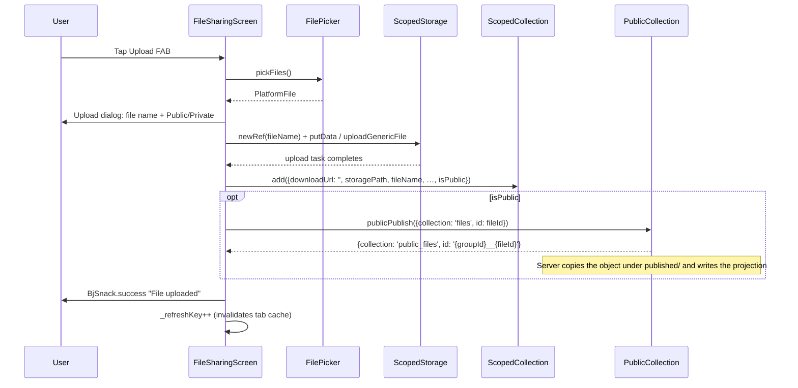

# Storage — Developer Guide

## Overview

The Storage app (`packages/storage`) is a group-scoped file sharing package. It lets users upload arbitrary files, keep them private to their group or publish a copy through `public_files`, share files with specific users, and download or delete files they own or can access. It also has a client view for the group's portal clients and per-group Storage plans (free tier, pay as you go, unlimited). File metadata uses `ScopedCollection`; uploads use `ScopedStorage`. These gateways scope data and attribute Firestore operations and uploaded objects to the `storage` app for Usage Meter.

---

## Package identity

| Constant | Value |
|----------|-------|
| `APP_ID` | `'storage'` |
| Route key | `'storage'` |
| Wiki doc slug | `'storage'` |
| pubspec asset path | `documentation/storage/` |

---

## Architecture

```
FileSharingScreen (StatelessWidget) → ClientViewSwitch
├── client: StorageClientScreen (storage_client_view.dart)
└── member: FileSharingMemberScreen (StatefulWidget)
├── ScopedCollection('files', appId: 'storage')   ← Firestore metadata + metered reads/writes
├── ScopedCollection('storage_usage', appId: 'storage') ← Storage app usage summaries
├── ScopedStorage(folder: 'files', appId: 'storage') ← Firebase Storage + attribution metadata
├── PublicCollection(source: 'files', appId: 'storage') ← published file projections and copies
├── NotificationService(appId: 'storage')          ← In-app notifications
├── UserSearchScreen (shared_ui)                   ← GroupMemberDirectory-backed share picker
├── PlatformService (shared_services)              ← Upload + download abstraction
├── StoragePlanService (src/storage_plan.dart)     ← storageBillingStatus / storageBillingSetPlan
├── portalGivesApp / listPortalClientsForApp       ← client-portal checks and client picker data
└── src/widgets/* (bluejay_design)                 ← presentational widgets, no data access
```

`FileSharingScreen` (`lib/file_sharing_screen.dart`) is the entry point. It is a `ClientViewSwitch` (see [platform changes, PR #3162](../platform_changes/developer.md)): an active portal client gets `StorageClientScreen`, everyone else `FileSharingMemberScreen`. The member screen has a three-tab `TabBarView`, or four when the group's portal gives clients Storage. Apart from `StoragePlanService` (the two plan callables), there is no service class: the member screen's Firestore, Storage and callable logic lives in `_FileSharingScreenState`, and the client view's in `storage_client_view.dart`. The UI is built on the shared `bluejay_design` package (`Bj*` components, `BjSnack` for every message), and the presentational pieces live under `lib/src/` and take data and callbacks only:

| File | Contents |
|------|----------|
| `src/models.dart` | `SharedFile`, `StorageUsageSummary` (re-exported from `file_sharing_screen.dart`) |
| `src/folders.dart` | `FolderTree`: what a folder holds (folders by name, then files newest first), the path down to a folder, everything inside one, and where an item may move. An item whose folder isn't in the list shows at the top level |
| `src/widgets/folder_row.dart` | `FolderRow`, `FolderRowActions`, `folderMenuActions` (Open; for the owner Rename, Move to folder, Share, Delete), and `FolderBar`, the breadcrumb with an up button and **New folder** |
| `src/storage_plan.dart` | `StoragePlanStatus` (the `storageBillingStatus` response), `StoragePlanService`, `bytesPerGb` (GiB), `formatPrice` ("CA$0.0644", up to four decimals below a dollar), `formatGb` ("50 GB", "12.5 GB") |
| `src/format.dart` | `formatBytes`, `formatDateShort` ("Nov 10", with the year when it isn't the current one), `formatDateTime` ("2026-11-10 14:05"), `usernameOf` (email local part), `filesLabel` |
| `src/file_kind.dart` | `FileKind` enum (image, pdf, document, spreadsheet, presentation, video, audio, archive, code, other) mapped from the lower-cased extension after the last dot, and `FileKindIcon` |
| `src/widgets/storage_layout.dart` | `StorageLayout`: `BjPage` titled "Storage" with the Storage plan action (`onOpenPlan`; no button when null) and the refresh action, a `NestedScrollView` whose usage card scrolls away above `BjPinnedTabs` (`labels`: `tabLabels` = Public, My Files, Shared, or `tabLabelsWithClients`, which adds From clients), and the upload FAB |
| `src/widgets/usage_card.dart` | `StorageUsageCard` (`BjHeroCard`); `planLabel(plan)` gives the subtitle's plan part |
| `src/widgets/storage_plan_screen.dart` | `StoragePlanScreen`: usage hero, plan chooser, price and billing sections. Takes `load` and `setPlan` callbacks, so it renders in tests without Firebase |
| `storage_client_view.dart` | `StorageClientScreen` (data) and `StorageClientView` (presentation) for portal clients, `storagePortalCard` / `StoragePortalCard` for the portal home, and the pure helpers `clientUploadProblem`, `newSharedFileCount` and `loadClientFiles` |
| `src/widgets/file_tab_body.dart` | `FileTabBody`: `BjSnapshotView` with skeleton loading, "Couldn't load files" error with retry, empty state, and a `BjSectionHeader` with count over `BjResponsiveGrid.rows` (min tile width 420, at most two columns); every state supports pull-to-refresh |
| `src/widgets/file_row.dart` | `FileRow` (`BjListRow`), `FileRowActions`, `VisibilityPill`, `fileMenuActions` |
| `src/widgets/upload_button.dart` | `UploadButton` (`BjProgressFab`, "Uploading N%" while busy) |
| `src/widgets/dialogs.dart` | `showUploadDetailsDialog`, `showFileDetailsDialog`, `deleteConsequences`, `confirmDeleteFile` (`showBjConfirm`) |

Widget tests (`test/widgets_test.dart`) cover these with fakes in `test/support/fakes.dart`; `test/storage_plan_test.dart` covers the plan model, formatting and screen, and `test/storage_client_view_test.dart` the client view, its upload checks and the portal card. `test/screenshots_test.dart` is opt-in and writes to the git-ignored `test/screenshots/out/`.

---

## Entry point / routing

Registered in `lib/routing/app_router.dart`:

```dart
'storage': (user) => FileSharingScreen(currentUser: user),
```

The app-route builder in the same file also matches `appId == 'storage'` and passes `openSettingsOnStart: args?['screen'] == 'settings'`. The App settings screen sends that for Storage's `settingsScreen` entry in `functions/app_group_settings.json` ("Storage plan", `requires: "read"`), and the member screen then opens `StoragePlanScreen` after its first frame. The client portal home shows `storagePortalCard`, registered in `lib/routing/portal_cards.dart`.

`currentUser` is a nullable `FirebaseAuth.User`. Upload and share actions are hidden when the user is null, and My Files/Shared show sign-in prompts. The Public tab has no explicit sign-in UI gate; its published Firestore projection and Storage copy are readable by any signed-in user, without access to the source group's tenant records. The tab filters projections to the active group's `sourceGroupId`. `isPublic` selects publication of a copy; it does not make the source `files` document cross-group readable.

---

## Data model

### `SharedFile`

Deserialized from Firestore via `SharedFile.fromFirestore(DocumentSnapshot)`.

| Field | Type | Notes |
|-------|------|-------|
| `id` | `String` | Firestore document ID |
| `downloadUrl` | `String` | New records store `''` for both visibility values. Legacy documents may contain a URL; current public downloads resolve the published copy from `public_files` instead. |
| `storagePath` | `String` | Canonical Storage object path (`groups/{groupId}/apps/storage/files/...`) |
| `fileName` | `String` | Original filename from the file picker |
| `displayName` | `String?` | User-supplied friendly name; `null` on legacy records |
| `userId` | `String` | UID of the uploader |
| `userEmail` | `String` | Email of the uploader (display only; missing/null source values deserialize to `''`) |
| `size` | `int` | File size in bytes |
| `createdAt` | `Timestamp` | Client `Timestamp.now()` recorded after upload |
| `isPublic` | `bool` | `true` = source is published to `public_files` and its file copied under `published/`; **defaults to `true`** when absent for backward compatibility |
| `sharedWithIds` | `List<String>` | UIDs of users with direct access |
| `sharedWithEmails` | `List<String>` | Emails of users with direct access (display only) |
| `fromClient` | `bool` | `true` only on a portal client's upload (written by `storageRegisterClientUpload`); defaults to `false` |
| `isFolder` | `bool` | `true` on a folder; defaults to `false` |
| `parentId` | `String?` | The folder it is in; `null` at the top level (missing or blank values read as `null`) |
| `clientUploaderUid` | `String?` | The client who uploaded it; `null` otherwise |

`isPublic` defaults to `true` in `fromFirestore` for old records. Current publication state is also reflected in the existence of the `public_files` projection: the server re-sync trigger removes a projection and its copied objects when a source is deleted or no longer satisfies `isPublic: true`. `SharedFile.fromPublished` uses the source `id` and published `storagePath`, but deliberately has no uploader UID or email because those fields are not projected.

---

## Firestore collection

Collection: `files` (group-scoped via `ScopedCollection`).  
`ScopedCollection.add()` automatically injects `groupId`, `appId`, `creatorId`, and `ownerIds`. Its `query` adds the active `groupId` filter only; it does not add an `appId` query filter. New documents carry `appId`, which is checked by Firestore rules. With no active group, the scoped query uses a sentinel that matches no documents.

Collection: `public_files` (read through `PublicCollection`, not `ScopedCollection`). It contains server-written projections keyed by `{sourceGroupId}__{sourceId}`. The Public tab requests the active group's projections and sorts them by `createdAt` in memory. Any signed-in user can read a published projection and its copied `published/` object; clients cannot write either one.

The `public_files` policy requires the source `storagePath` and `fileName`; the serialized projection is limited to 65,536 bytes. This limit applies to the Firestore projection, not the uploaded file's bytes. `scripts/firestore_admin/migrations/2026-11-05_publish_public_backfill.js` can publish existing eligible records. It is a dry run by default; `--confirm` writes a backup and applies the publication.

Collection: `storage_usage` (group-scoped via `ScopedCollection`).

| Field | Type | Notes |
|-------|------|-------|
| `userId` | `String` | Uploader UID for per-user totals, or `__group_total__` for group aggregate |
| `kind` | `String` | `user_total` or `group_total` |
| `totalBytes` | `int` | Aggregate uploaded bytes |
| `totalFiles` | `int` | Aggregate file count |
| `updatedAt` | `Timestamp` | Last server-side recalculation time |

### Required composite indexes

| Query | Fields |
|-------|--------|
| Public files tab | none: it reads `public_files` by `sourceGroupId` and sorts client-side (the `files` `groupId` + `isPublic` + `createdAt` index is unused) |
| My Files tab | `groupId` ASC + `userId` ASC + `createdAt` DESC |
| Shared tab | `groupId` ASC + `sharedWithIds` ARRAY_CONTAINS + `createdAt` DESC |
| From clients tab | none: `groupId ==` + `fromClient == true`, equality only, sorted by `createdAt` client-side |
| Client view | none: `queryAsClient()` reads `client_files` by `groupId ==` + `clientUids array-contains`, sorted client-side |

Create via Firebase Console → Firestore → Indexes, or let the app generate the auto-create link on first run.

---

## Firebase Storage layout

Files are uploaded via `ScopedStorage`:

```
groups/{groupId}/apps/storage/files/{uuid}_{originalFilename}
```

`ScopedStorage.newRef(fileName)` prepends a UUID v4 to guarantee uniqueness within the folder. `putBytes` and `PlatformService.uploadGenericFile` use metadata built by `buildMetadata()`, which injects `creatorId`, `groupId` and `appId` (there is no `visibility` key: a public file is published, `isPublic` on the Firestore doc). Uploads reject missing/empty attribution metadata.

---

Portal clients upload to a second folder, `groups/{groupId}/apps/storage/client_uploads/{uuid}_{originalFilename}` (`ScopedStorage(folder: 'client_uploads', appId: 'storage')`). It is the Storage app's `guestWritableFolders` entry in `security/storage_paths.json`, and its `guestUploadLimits` cap a client upload at 25 MB of images, PDF, plain text, CSV or Office types (see the generated table below).

---

## Upload flow



`showUploadDetailsDialog` returns an `UploadDetails` record `({String name, bool isPublic})`, or `null` on cancel. Visibility starts unselected and **Upload** is disabled until one is picked and the name is non-blank, so the app never picks a visibility by default. The name field is pre-filled with the picked filename up to its first `.`.

Before the dialog opens, `_checkRoomFor(file.size)` reloads the plan (`storageBillingStatus`) and checks `StoragePlanStatus.allowsUpload(bytes)`: on the free tier, current group usage plus the file must fit in the free tier. If it doesn't, a `showBjConfirm` titled "Not enough storage" replaces the upload (the message differs for `canManage` callers), and **See storage plan** opens the plan screen. If the plan can't be read, the upload goes ahead. This check is client-side only; neither the Storage rules nor any callable refuse an upload past the free tier. The plan is reloaded after a successful upload.

**Web path:** `_filesStorage.putBytes(ref, bytes)` with real-time `snapshotEvents` progress.
**Mobile path:** `PlatformService.uploadGenericFile(ref, file, metadata: _filesStorage.buildMetadata(...))`, progress set to 1.0 on completion. Both paths carry required attribution metadata from `ScopedStorage`.

---

## Share flow

1. Owner chooses **Share** from the file's row menu. When `portalGivesApp(activeGroupDocId, 'storage')` was true at `initState`, a "Share with" sheet first offers **People in your group** or **A client**. **A client** opens `showClientPicker` (`shared_ui/client_picker.dart`) loaded from `listPortalClientsForApp(groupId, 'storage')` (`portalListAppClients`), excluding UIDs already in `sharedWithIds`; one client is picked. Otherwise `UserSearchScreen` opens in multi-select mode. It loads active group `GroupMember` records through `GroupMemberDirectory`, excluding guests, draft accounts, the current user, and users already on the file.
2. On return, the client calls `storageShareFile` with the file ID + selected user IDs.
3. The callable validates authentication, the caller's active Storage entitlement in the source group, ownership, and every new recipient's Storage access server-side, then updates `sharedWithIds` / `sharedWithEmails`. A recipient passes as a Storage member of the group or as an active portal client holding `{groupId}:storage:guest`. For a client, the `files` entry in `CLIENT_LINKED_COLLECTIONS` (`functions/_client_links.js`, `uidFields: ['sharedWithIds', 'clientUploaderUid']`) then sets `clientUids`, writes the `client_files` copy and notifies the client ("{group} shared a file with you"; never for the client's own uploads).
4. The client calls `NotificationService.addForRecipients` once for the newly added recipient IDs. This sends a `notificationsSend` callable request; the server creates notifications and owns `senderId`, `createdAt`, and `isRead`. Notification failures are logged and do not roll back sharing. The current callable adds recipients; it has no unshare operation.

---

## Folders

A folder is a `files` doc with `isFolder: true` and no stored object; anything in it carries the folder's id in `parentId`. Keeping folders in `files` means the policy table, rules, sharing callable, client links and audit trail apply to them unchanged.

- **Browsing:** My Files and Shared still load with their one query each (`_query` keeps it for the refresh, so opening a folder doesn't reload). `_buildFolderTab` builds a `FolderTree` from the result and lists `childrenOf` the open folder (`_myFolderId`, `_sharedFolderId`; a folder that has gone falls back to the top level) under a `FolderBar`. `FileTabBody.header` shows the bar above the list and above the empty state.
- **New folder:** `_createFolder` adds the doc through `ScopedCollection.add` in the folder open on My Files (`fileName` and `displayName` the name, `size: 0`, `isPublic: false`, empty `storagePath`).
- **Upload:** `_uploadFile` records the folder open when it started and passes it to `_saveFileMetadataToFirestore` as `parentId`.
- **Move and rename:** `_moveItem` offers `FolderTree.moveTargets` in `showMoveToFolderSheet` and updates `parentId` (`FieldValue.delete()` for the top level); `_renameFolder` updates `displayName` and `fileName`. Both are the owner's own writes.
- **Share:** a folder goes through `storageShareFile` like a file. The server trigger `onStorageFolderItemWritten` then gives everything the owner keeps in it the same recipients, down through the folders inside, and gives an item later filed in the folder its recipients (see [Interfaces](interfaces.md#onstoragefolderitemwritten)). The client's notification says "shared a folder with you".
- **Delete:** `storageDeleteFile` on a folder deletes everything of the caller's in it; `confirmDeleteFolder` counts `descendantsOf` for the warning.
- **Clients:** the `files` client projection carries `isFolder`, `loadClientFiles` leaves folders out of a client's list, and a client is notified once for a shared folder, not for each item in it (`_client_links.js`).
- **Usage:** `toTrackedFile` ignores folders, so they never count as files or bytes, and `_loadUsageFromFiles` skips them too.

`scripts/firestore_admin/upload_private_file.js` files an upload in a folder with `--folder <id>` or `--folder-path "A/B"` (which makes missing folders the way `_createFolder` does).

---

## Delete flow

Delete is performed by callable `storageDeleteFile`:

1. Validate caller authentication and active Storage access in the file's stored group.
2. Validate caller owns the file.
3. Delete the Storage object path from `storagePath` (fallback: parse legacy `downloadUrl`).
4. Delete the Firestore metadata document. A missing Storage object is tolerated so a stale metadata record can still be removed. Deleting the source document also causes the public namespace trigger to remove its published projection and copied object.

Only the file owner (checked via `widget.currentUser?.uid == file.userId`) gets **Delete** in the row menu. `confirmDeleteFile` shows `showBjConfirm` with the consequences from `deleteConsequences(file)`: permanent deletion, loss of access for the N people in `sharedWithIds` (when non-empty), and, for a public file, that its link stops working and it leaves the Public tab.

## Client view and client uploads

`StorageClientScreen` is what an active portal client sees. `loadClientFiles()` runs `ScopedCollection('files').queryAsClient()`, which reads the `client_files` copies whose `clientUids` contain the caller, sorted newest first. The copies hold the projected fields `fileName`, `displayName`, `size`, `contentType`, `mimeType`, `createdAt`, `fromClient`, `clientUploaderUid` and `isFolder`, plus the tenant fields and `clientUids`. Folders are dropped from the list, since a shared folder's files arrive as copies of their own. `StorageClientView` splits the rest into **Shared with you** (`clientUploaderUid != uid`) and **Sent by you**. The page is titled "Files", has a refresh action and an Upload `BjProgressFab`, and names the business in its empty states and upload tooltip with `ActiveGroupService.activeGroupDocumentName`: the group's legal name when one is set, else its name ("the business" when empty). See [Platform changes](../platform_changes/developer.md) (PR #3319) for the legal name itself.

- **Download:** `storageDownloadFile?fileId=<id>` with the client's ID token. The copy has the same id as the `files` doc; the endpoint admits a caller whose `clientUids` entry and `{g}:storage:guest` entitlement match (`isClientFileReader`).
- **Upload:** `clientUploadProblem(name, size)` mirrors the Storage rules' guest limits and refuses a file over 25 MB ("Files can be up to 25 MB.") or of another type ("Send a photo, PDF, text or Office document."). The file goes to `client_uploads` with its detected content type (the rules check it), and then `storageRegisterClientUpload({groupId, storagePath, fileName})` writes the `files` doc. A client can't write `files` itself: `fromClient`, `clientUploaderUid` and `clientUids` are server fields.
- **Clean-up:** `storageCleanUpClientUploads` (daily, 04:17 Toronto time) deletes `client_uploads` objects older than a day that were never registered, in groups whose portal is enabled.
- **Portal card:** `StoragePortalCard` is a `BjStatTile` "New files" counting files shared with the client in the last 14 days (`newSharedFileCount`, `kNewFileWindow`), excluding their own uploads. It renders nothing until loaded and opens the app on tap.

On the member side, the **From clients** tab (`_buildFromClientsTab`) lists `files` with `fromClient == true`, showing the sender. `storageDownloadFile` lets every Storage member of the group download a `fromClient` file, even though it is private and owned by the client. The member screen keys its `DefaultTabController` on whether the tab is present, so the controller is rebuilt when `portalGivesApp` resolves.

---

## Storage plans

The plan lives server-side in `functions/_storage_billing.js` (callables in `functions/storage_billing.js`, metered as Storage):

| Plan | Behaviour |
|------|-----------|
| `free` (default) | Up to the free tier (`platform_config/storage_billing.freeTierGiB`, default 50 GiB) |
| `pay_as_you_go` | No limit; the admin who turned it on (`payerId`) is billed monthly for GiB-months above the free tier, at the price and free tier recorded when they accepted |
| `unlimited` | Groups in `unlimitedGroupIds` (default `['bluejay']`); never billed, and `storageBillingSetPlan` refuses to change them |

Usage is the sum of Usage Meter's `usage_storage` docs for the group with `appId == 'storage'`, which come from the bucket itself, so it includes `client_uploads` and never trusts the client-written `files.size`. The price per GiB-month is Usage Meter's `storageByteDays` list price × 30 days (US$0.023), times `markup` (2), in CAD at `cadPerUsd` (1.4), unless `pricePerGiBMonth` overrides it.

- `storageBillingStatus` (any group member or platform admin) returns plan, usage, free tier, price, the month's estimate and, for admins, the payer and whether the caller has a default card.
- `storageBillingSetPlan` (group admins or platform admins): turning on `pay_as_you_go` needs `acceptedPricePerGiBMonth` equal to today's price and a default Wallet card. Going back to `free` needs usage under the free tier. It appends to the doc's `history`, notifies the other group admins and returns the new status.
- `storageBillingMonthlyOverage` (06:10 on the 2nd, Toronto time) bills the previous UTC month. For each group on pay as you go on any day of it, it sums `max(0, GiB held that day − free tier)` over those days from the nightly `storageByteDays` gauges, divides by the days in the month, and writes one `billing_events/storage_overage_<groupId>_<YYYY-MM>` (`usageUnit`, category `storage-overage`) to the payer. Amounts under 0.01 aren't billed, and `lastBilledPeriod` stops a re-run billing twice.

`storage_billing/{groupId}` is server-written (kind `server`, read by its `payerId`, on the audit trail under Storage) and is not in the generated table in [Data and permissions](#data-and-permissions). The Storage app reads it only through `storageBillingStatus`.

Client side, the member screen loads `StoragePlanStatus` at `initState` (signed-in only), on refresh, after an upload and when the plan screen closes, and passes it to `StorageUsageCard`. `planLabel` gives "Free tier · <used> of <free>", "Pay as you go", or "Unlimited storage" (also while the plan is loading or can't be read). `StoragePlanScreen` shows a usage hero against the free tier, a plan chooser (`BjOptionCards`, disabled unless `canManage`; hidden for unlimited, which shows a note instead), a warning when an admin has no default card, a Price section (per GB per month, free amount, per 100 GB per month) and, on pay as you go, a Billing section (payer, this month's estimate). Each plan change is confirmed with `showBjConfirm` first.

---

## File row actions

`fileMenuActions` builds each row's overflow menu in a fixed order: **File details**, **Copy link** (only when `isPublic`), **Download**, **Share** (owner only), **Delete** (owner only, destructive, last). On non-compact widths (`BjBreakpoint.isCompact`) the row also has a trailing Download button; tapping the row opens `showFileDetailsDialog`. Row pills show visibility, size, and, for the owner, `Shared with N` from `sharedWithIds.length`. The subtitle is `Uploaded by <user>` (or `Shared by <user>` on the Shared tab) plus a short date; published copies have no `userEmail`, so the Public tab shows only the date.

---

## Usage tracking architecture

The app's displayed usage is maintained server-side by `functions/storage_usage.js`:

- Trigger: `onStorageFileWritten` on `files/{fileId}`
- Scope guard: only processes documents where `appId == 'storage'`
- Updates two summary documents in `storage_usage`:
  - per-user total (`kind: user_total`)
  - per-group aggregate (`kind: group_total`, `userId: '__group_total__'`)

The UI reads `storage_usage` first, then falls back to summing `files.size` when summary docs are missing (for example, immediately after deployment before all legacy files have churned through writes). This app-specific collection is distinct from Usage Meter's `usage_storage` object totals and `usage_storage_objects` ledger.

---

## Platform Usage Meter interfaces

Usage Meter currently accounts for Storage objects and Firestore activity through these interfaces:

- Every upload through `ScopedStorage` carries non-empty custom metadata keys `creatorId`, `groupId`, and `appId`. Storage app files have paths under `groups/{groupId}/apps/storage/files/...`; the path supplies group/app attribution, while `creatorId` supplies the uploader UID.
- Cloud Storage finalize/delete triggers maintain Usage Meter's `usage_storage_objects` per-object ledger and `usage_storage` totals for `(groupId, uid, appId)`. These collections are distinct from the Storage app's `storage_usage` UI rollups.
- The bucket events also record `storageUploads` in server-owned `usage_daily` metrics. A nightly bucket recount reconciles missed events and re-attribution, then writes `storageByteDays` gauge samples.
- `ScopedCollection` uses `BluejayFirestore.forApp('storage')`; file-list and usage queries are metered against the Storage app. The group-admin lookup also uses the metered gateway. Cache-served Firestore reads are not billed by the client metering layer.

Storage bucket event handlers catch and log failures rather than blocking uploads/deletes; the nightly recount repairs missed ledger updates. The admin-only `usageStorageRecount` callable supports a dry run and returns totals plus attribution-coverage and reconciliation summaries (see Interfaces).

---

## Usage overview in UI

`FileSharingScreen` shows usage (signed-in users only) in `StorageUsageCard`, a `BjHeroCard` above the tabs that scrolls away while the tabs stay pinned:

- Title `<bytes> stored`, subtitle `<N files> · <planLabel(plan)>` (see [Storage plans](#storage-plans))
- For current-group admins (determined from `groups.adminIds`): a footer `Group: <bytes> · <N files>`, and when the group total is above zero a progress bar of the user's share with `Your files are N% of the group's storage`

Implementation detail:

- Per-user and group totals are read from live `storage_usage` streams (`StreamBuilder`).
- If rollup docs are missing, the UI falls back to one-time summations from `files` (`_loadUsageFromFiles`).

---

## Tab caching and refresh

The screen uses a `_refreshKey` integer. Each tab's `FutureBuilder` is keyed `ValueKey('<public|myfiles|shared>_$_refreshKey')` and the tab widget is cached in `_cachedPublicTab` / `_cachedMyFilesTab` / `_cachedSharedTab`. When `_refreshKey` increments, all caches are invalidated and a fresh Firestore `.get()` is issued.

`_refreshKey` increments on:
- Successful upload
- Successful share
- Successful deletion
- Manual ↺ refresh button tap
- Pull-to-refresh on any tab state (calls the same refresh, then waits 250 ms)

Tabs use **one-time `.get()` queries** — they are **not** real-time streams. Users must refresh manually to see teammates' new uploads.

---

## Notifications

`NotificationService(appId: APP_ID)` sends one batch through `notificationsSend`; the server writes one document per eligible recipient. The client payload is:

```dart
{
  'title': file.isFolder
      ? '$sharerName shared a folder with you'
      : '$sharerName shared a file with you',
  'body': file.name, // displayName ?? fileName
  'appName': 'File Storage',
  'context': {'fileId': file.id},
}
```

The server adds `recipientId`, `senderId`, active `groupId`, `appId`, `isRead: false`, and a server `createdAt`. Notification send failures are caught and printed as `debugPrint` — they do not block the share operation.

---

## Data and permissions

<!-- generated:data-permissions:start -->
<!-- Generated from security/collections.json and security/storage_paths.json by `node scripts/docs/nightly_docs_batch.js render-permissions`. Do not edit between these markers: change the policy table and re-render. -->

**Firestore** — policy from `security/collections.json`, enforced by the generic rule in `firestore.rules`. App tiers are the caller's `<groupId>:<appId>` entitlements (base, `:edit`, `:admin`, `:guest`); "own" docs are those whose `creatorId` is the caller or whose `ownerIds` contains them.

| Collection | Kind | Who reads | Who writes (client) | Notable flags |
|---|---|---|---|---|
| `client_files` | tenant (server-written) | Members of the doc's group with `storage` (base, `:edit`, `:admin`) | None (Admin SDK only) | `serverWritten` |
| `files` | tenant | Members of the doc's group with `storage` (base, `:edit`, `:admin`) | `:edit`/`:admin` any doc; the base tier its own docs | published to `public_files` · server-only fields: `clientUids`, `clientUploaderUid`, `fromClient` |
| `storage_usage` | tenant (server-written) | Members of the doc's group with `storage` (base, `:edit`, `:admin`) | None (Admin SDK only) | `serverWritten` |

- Every rule requires a signed-in `ACTIVE` account; tenant access also needs the doc's `groupId` in the caller's access index (and not in `denied_scopes`). ACTIVE platform admins read every collection (EX-ADMIN-1).
- Client creates of tenant docs must set `creatorId` to the caller and use an auto id, a UUID, the `groupId`, or a `{groupId}__…` key; `groupId`, `appId` and `creatorId` never change on update. "Admin SDK" writes come from Cloud Functions.
- Subcollections not listed follow their parent: readers of the parent read them, editors of the parent write them, and readers may add `comments` docs they author.

**Storage** — path families from `security/storage_paths.json` (rendered into `storage.rules`).

| Path | Family | Who reads | Who writes (client) |
|---|---|---|---|
| `groups/{groupId}/apps/storage/client_uploads/**` | `group_apps` | Members of the file's group with the app; ACTIVE platform admins | Base tier creates and edits/deletes its own files; `:edit`/`:admin` any; `:guest` only their own, and only in the app's `guestWritableFolders` (metadata `groupId`/`appId` must match the path, `creatorId` is the uploader) |
| `groups/{groupId}/apps/storage/files/**` | `group_apps` | Members of the file's group with the app; ACTIVE platform admins | Base tier creates and edits/deletes its own files; `:edit`/`:admin` any; `:guest` only their own, and only in the app's `guestWritableFolders` (metadata `groupId`/`appId` must match the path, `creatorId` is the uploader) |
| `users/**` | `legacy_users` | No client access | No client access |
| `shared_files/**` | `legacy_shared_files` | No client access | No client access |
| `public/**` | `legacy_public` | No client access | No client access |

- `legacy_users`: legacy prefix, no client access; migration M8 moves it to `groups/{groupId}/apps/storage/files/`.
- `legacy_shared_files`: legacy prefix, no client access; migration M8 moves it to `groups/{groupId}/apps/storage/files/`.
- `legacy_public`: legacy prefix, no client access; migration M8 moves it to `groups/{groupId}/apps/storage/files/`.

<!-- generated:data-permissions:end -->

## Security / authorization

| Operation | Guard |
|-----------|-------|
| View Public tab | No explicit widget sign-in gate; the rules let any signed-in user read published projections and `published/` objects. The source `files` document remains group-scoped. |
| View My Files / Shared tabs | `currentUser != null` check in widget build, plus server-side Firestore/Storage rules |
| Upload | `currentUser != null` guard; FAB hidden if null |
| Share | Owner-only in the UI (the **Share** menu item is offered only when `currentUser.uid == file.userId`); `storageShareFile` checks ownership server-side |
| Delete | Owner-only UI + server-authoritative callable (`storageDeleteFile`) enforces authentication, active Storage access, and ownership before deleting Storage + Firestore records |

`ScopedCollection.query` filters by active `groupId`; its writes inject group/app ownership fields, and Firestore rules evaluate stored `appId` and other permission fields. `ScopedStorage` puts group/app in the object path and injects attribution metadata. The private-file endpoints independently validate active Storage access and file access before serving data.

---

## Dependencies

| Package | Role |
|---------|------|
| `shared_services/scoped_collection.dart` | Group-scoped Firestore access using metered Firestore |
| `shared_services/bluejay_firestore.dart` | App-attributed Firestore gateway for raw group-admin lookup |
| `shared_services/scoped_storage.dart` | Group-scoped Firebase Storage with required attribution metadata |
| `shared_services/notification_service.dart` | In-app notifications |
| `shared_services/service_locator.dart` | `getPlatformService()` — upload/download/clipboard |
| `shared_ui/user_search_screen.dart` | Multi-user picker for sharing |
| `shared_ui/client_picker.dart` | `showClientPicker` for sharing with a portal client |
| `shared_services/client_view_switch.dart` | `ClientViewSwitch`: member screen or client view |
| `shared_services/portal_clients.dart` | `portalGivesApp`, `listPortalClientsForApp` |
| `shared_services/portal_cards.dart` | `PortalCard` / `PortalCardContext` for the portal home card |
| `shared_services/mime_type_helper.dart` | Content type of a client upload |
| `bluejay_design` | Shared design system: page, cards, list rows, pills, state views, dialogs, snack bars |
| `file_picker` | File selection on all platforms |
| `url_launcher` | (Available; used via PlatformService for download) |
| `cloud_functions` | Calls `storageShareFile`, `storageDeleteFile`, `storageRegisterClientUpload`, `storageBillingStatus`, `storageBillingSetPlan`, and, for authorized link resolution, `storageGetFileDownloadUrl` |
| `firebase_storage` | Upload + download URL retrieval |

---

## Edge cases and constraints

- **Empty display name:** The upload dialog's **Upload** button stays disabled while the name is blank, and `_uploadFile` also returns early on a `trim().isEmpty` name. The stored `displayName` is trimmed.
- **Backward-compatible `isPublic`:** Legacy documents without `isPublic` field are treated as public. Avoid relying on absence of the field as a "private" signal.
- **Legacy publication state:** `SharedFile.fromFirestore` treats a missing `isPublic` as `true`, but the public namespace publishes only records that satisfy the server's `isPublic: true` condition and have a projection. A model default alone does not publish an older record.
- **`sharedWithIds` array size:** Firestore `array-contains` queries work only on flat arrays. There is no cap on `sharedWithIds`, but Firestore document size limit (1 MB) applies.
- **Server-side delete path validation:** `storageDeleteFile` uses `storagePath`, falling back to the object path in a legacy `downloadUrl`, and verifies that the resolved object belongs to this group's Storage app (or the matching legacy owner path) before deletion.
- **No per-file size limit for members:** Member uploads have no size ceiling. The only limit is the client-side free-tier check described in [Upload flow](#upload-flow). Portal clients are capped at 25 MB by the Storage rules.
- **No MIME-type filtering for members:** Members can upload any file type `FilePicker.platform.pickFiles()` accepts. Client uploads are limited to images, PDF, text, CSV and Office types.
- **Client uploads can't be deleted in the app:** the client owns the `files` doc, but the client view has no delete action, and `storageDeleteFile` requires the base Storage tier, which a client doesn't hold. Members aren't the owner, so they get no **Delete** either.
- **Orphan objects after metadata failure:** Storage upload and Firestore metadata creation are separate operations. If the object upload succeeds but `files.add()` fails, the object can remain without a `files` record; Usage Meter still attributes and counts it from the object path/metadata, and the nightly recount keeps its ledger consistent.
- **Publication failure:** The tenant object and `files` document are written before `publicPublish` runs. If publishing fails, the source record can remain without a projection; retry by publishing again after the cause is resolved.
- **URL handling:** All new source documents store an empty `downloadUrl`. Public URLs are resolved from the published projection and its copied object; private files are streamed through the authenticated `storageDownloadFile` HTTP endpoint. `storageGetFileDownloadUrl` separately returns a five-minute signed URL to authorized callers and is not used by the current UI download path.
- **Download validation:** Public downloads resolve and validate a published-object path from the projection; the source `downloadUrl` is empty for new files. Private downloads obtain an ID token and send it as a bearer token to `storageDownloadFile`; failures are converted to a user-facing snackbar. `_copyFileUrl` rejects private files.
- **Firestore app attribution:** `ScopedCollection` app reads/writes and the raw group-admin lookup are metered against app ID `storage`. `appId` is not an implicit filter on `ScopedCollection.query`; only the active `groupId` is added, while Firestore rules check document permission fields.
- **Storage attribution:** Raw Storage access is routed through `ScopedStorage`; upload helpers require `creatorId`, `groupId`, and `appId` metadata. The Usage Meter verifies metadata claims and reconciles each object into `usage_storage` and the per-object `usage_storage_objects` ledger.
